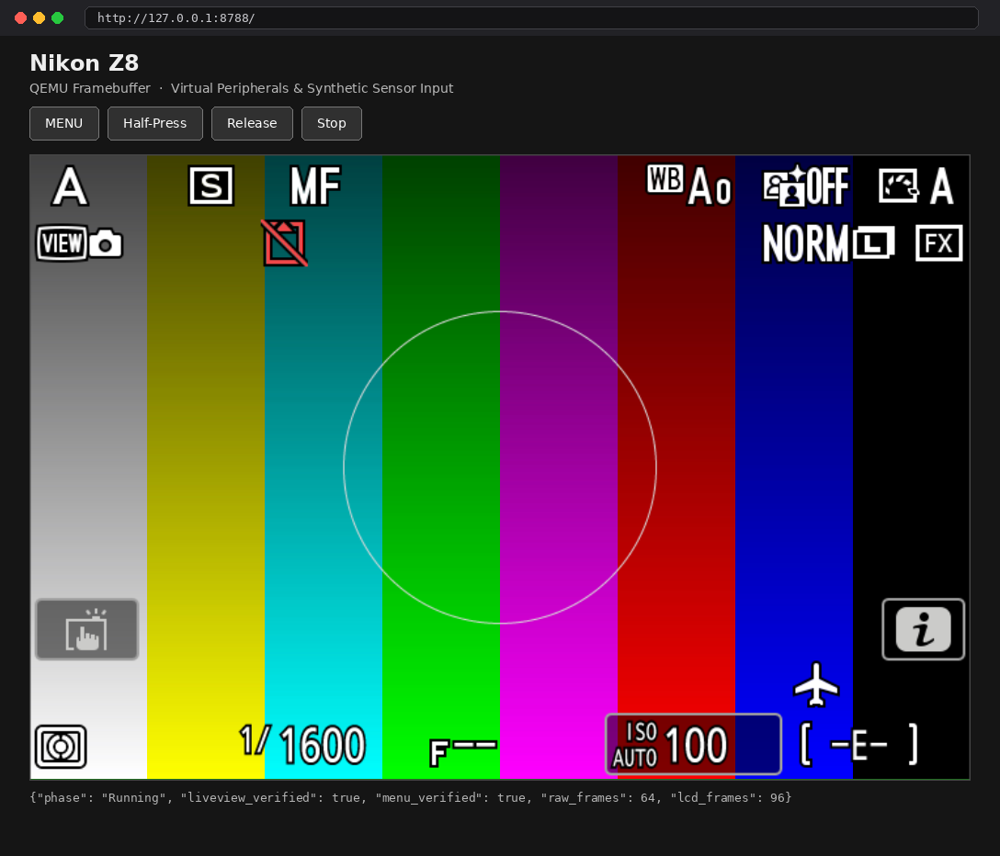
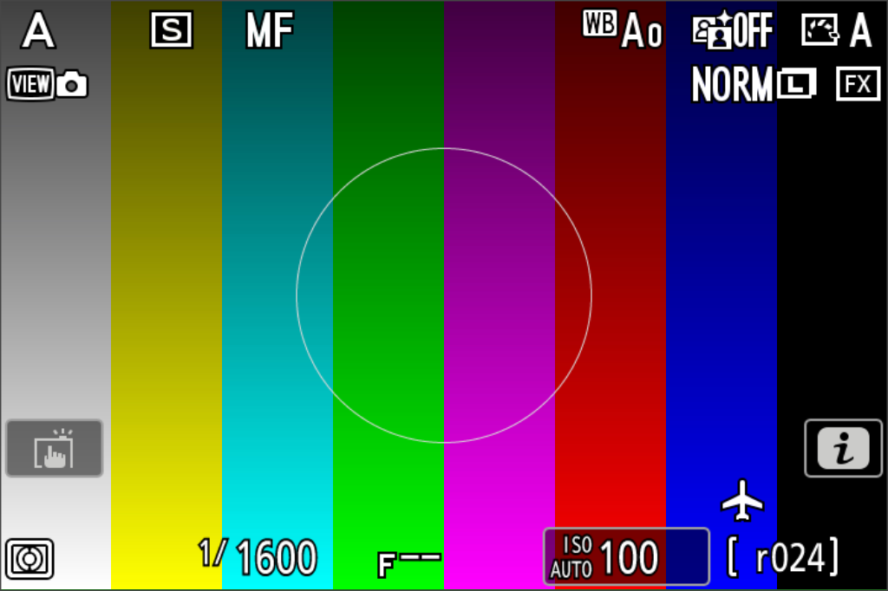
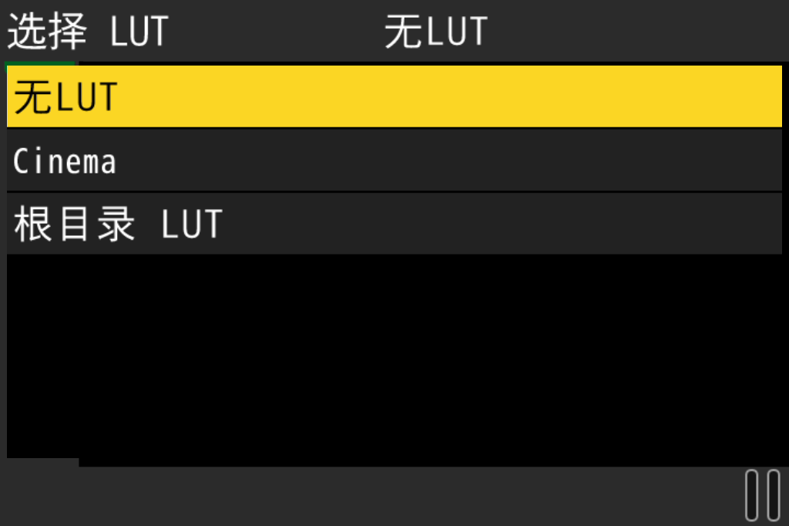
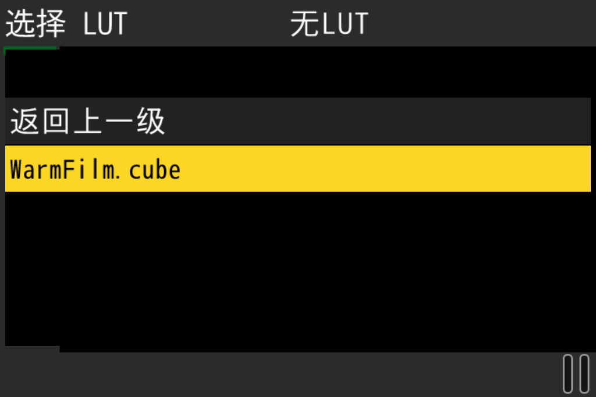
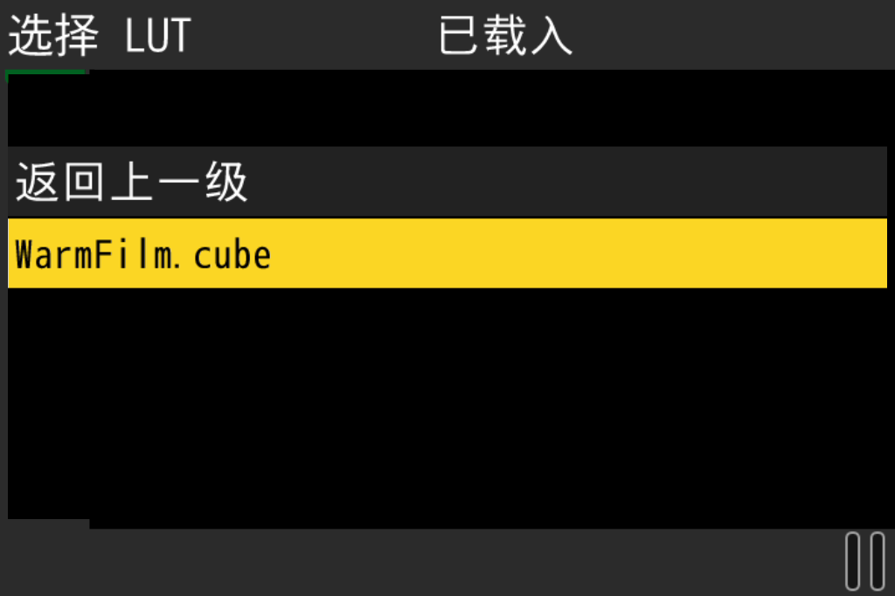
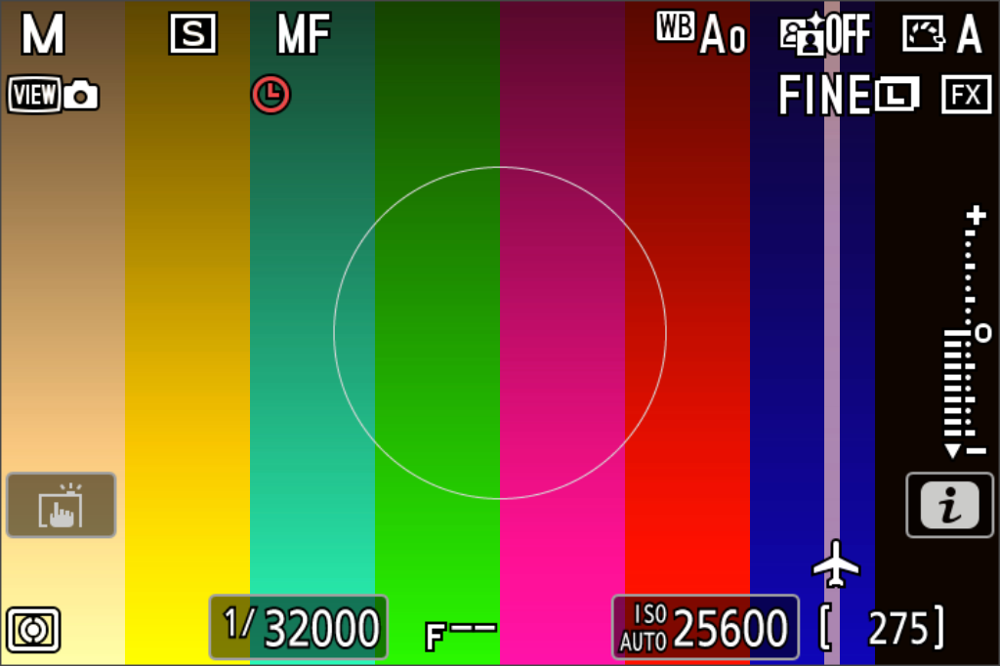
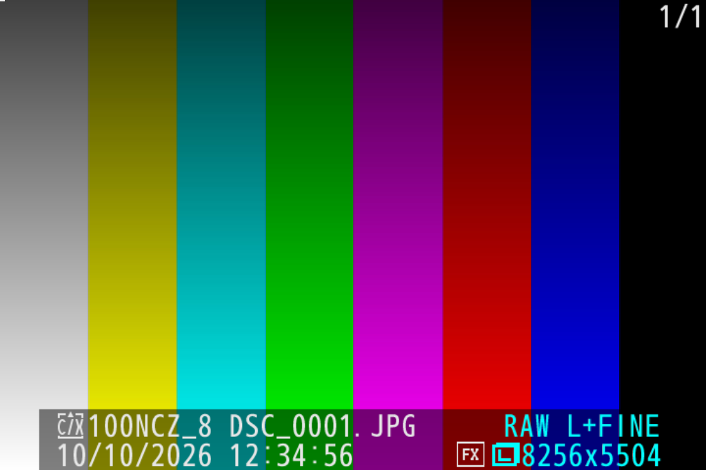

# Nikon Z8 Firmware Emulator (`z8-qemu`)

**English** | [简体中文](README.zh-CN.md) · [Detailed Feature & V71.7-r7 Emulation Reference (EN)](docs/features-and-usage.md) · [V71.7-r7 详细功能与仿真验证手册 (简体中文)](docs/features-and-usage.zh-CN.md)

`z8-qemu` is an experimental QEMU-based hardware emulator for **Nikon Z8 firmware C3.11** (machine `nikon-z8-bringup`), adapted from [WonderLantern/z9-qemu](https://github.com/WonderLantern/z9-qemu) and pinned to upstream QEMU `10.2.4`.

It lets you boot an extracted stock Z8 `MAIN` firmware image on a Linux or Windows WSL2 host, navigate native camera menus in your browser, test synthetic Live View rendering, capture single-shot RAW (`.NEF`) files onto a virtual CFexpress card, run C32/C64 Picture Control NAND experiments, and perform **whole-guest emulation & automated verification of integrated Fenestra Z8 `V71.7-r7` (`Z8-v71.7r7-LutPreview-362ee2a5`, internal `04.06.p0`, Bootguard `0x8394568f`) firmware, native Photo Shooting Menu 3D LUT preview, EXPEED 7 CEVA-XM6 DSP diagnostics, and all 5 `.wlm` plugins** without touching physical hardware.

> [!IMPORTANT]
> **Emulator Only — Never Flash Derived Files to a Camera**
> - This project runs entirely on your computer. It **never** connects to or flashes a physical camera.
> - Official Nikon firmware containers, decryption keys, sensor dumps, prebuilt Fenestra firmware images, `.wlm` binaries, and `ZF_GRAIN.BIN` tables are **not** included in this repository; you must extract stock `MAIN` from your own official `Z_8_0311.bin` package (or supply your own locally built test image).
> - Slot-expansion and overlay tools generate modified local `MAIN` binaries strictly for QEMU experiments. They are **not** valid camera update packages and must **never** be written to a real camera.
> - The default `tools/build.py` builds **only** the clean root `qemu/` machine model and does **not** automatically apply `experiments/` patches or ship Fenestra binaries.

---

## Interface & Verification Preview

### Core Emulation (Stock Z8 C3.11 & Expanded C64 Slots)

| Browser Console (`127.0.0.1:8788`) | Synthetic LCD Live View |
| :---: | :---: |
|  |  |
| **Native Photo Shooting Menu** | **Expanded C64 Picture Control Slots** |
|  |  |

### `V71.7-r7` Whole-Guest Verification (`fenestra-z8` Integration — `#19-r7` 14/14 & `#20-r7` 13/13 PASS)

| Clean 7-Row `Fenestra` Home Menu | `Plugin Manager` (All 5 `.wlm` Plugins) |
| :---: | :---: |
|  |  |
| **Photo Shooting Menu Row 47 (`Select LUT` / `选择 LUT`)** | **Native 3D LUT Category Picker (`FENESTRA/LUTS/`)** |
|  |  |
| **Paginated `.cube` File List in Photo Menu** | **Loaded 3D LUT Status (`Ready` / `已载入`)** |
|  |  |
| **Live View with Real-Time 3D LUT Applied** | **`3D LUT` Plugin (`lut.wlm`) Root Menu** |
|  |  |
| **`Film Simulation` (`filmsim.wlm`) Root Menu** | **`filmsim.wlm` Debug & XM6 DSP Subpage** |
|  |  |
| **EXPEED 7 CEVA-XM6 Hardware DSP Diagnostic** | **`Live Photo` (`livephoto.wlm`) Root Menu** |
|  |  |
| **Dual-Card C64 `Slot card` (`slotcard.wlm`)** | **Runtime `Portrait Video` Gate (`portrait.wlm`)** |
|  |  |

---

## Feature Overview

| Feature | Entry Point | What Works Today | Current Scope & Limits |
| :--- | :--- | :--- | :--- |
| **Interactive Menus & Live View** | `Start-Z8.ps1` (Windows)<br>`tools/z8_run.py` (Linux/WSL) | Boots stock Z8 C3.11 into synthetic LCD Live View; browser UI sends `MENU` and half-press shutter; supports automated headless menu round-trip checks. | Uses host MCU peers and synthetic Bayer frames (~24 fps static color bars) rather than real CMOS/ISP hardware. |
| **Strict Bring-Up Probe** | `Test-Z8.ps1`<br>`tools/z8_bringup.py` | Runs bounded boot checks and halts immediately on any unmodeled MMIO register access. | Optional bootstrap/bus/serial/NAND fixtures are explicit test assumptions, not proof of bare-metal boot. |
| **Single-Shot NEF Capture** | `tools/z8_capture_probe.py`<br>`tools/z8_export_nefs.py` | Captures a full-resolution `8280×5520` 14-bit `.NEF` (uncompressed/packed14 or opt-in `F0` lossless14) to a virtual exFAT card and verifies decoded pixels via LibRaw. | Single post-trigger frame only; **RAW pre-release burst capture is not yet complete**. `F0` uses an upstream functional encoder (`HE`/`HE*` unsupported). |
| **C32 / C64 Picture Control Slots** | `tools/z8_slots_acceptance.py` | Expands custom Picture Control slots to **32 or 64** for both Photo and Video (`C-1`–`C-64`), including `.NP3` import, menu selection, virtual NAND save, and cold-boot restore. | Runs on a derived QEMU `MAIN` image; not enabled by default in `Start-Z8.ps1`. |
| **`V71.7-r7` Whole-Guest Firmware & 5-Plugin Verification** | Local `V71.7-r7` `MAIN` + virtual exFAT `FENESTRA/` card | Verifies clean 7-row `Fenestra`, all 5 trilingual `.wlm` plugins (`filmsim`, `livephoto`, `lut`, `slotcard`, `portrait`), Photo Menu Row 47 streaming `.cube` 3D LUT + 528 KiB L2 baked LUT + Movie `pool_suspend` (`0 B`) + reboot restore/clear (`#19-r7` 14/14 PASS, `#20-r7` 13/13 PASS), XM6 fallback & self-test UI, `0-diff` `.NEF`, and EVF Pool #6 DRAM layout. | Requires a locally built Fenestra `V71.7-r7` `MAIN` & card assets (not shipped here). QEMU models `1024×682` LCD only (no physical `1280×960` EVF panel or physical XM6 silicon); `V71.7-r7` is **`physical_camera_verified = false`**. |
| **Portrait HUD, EVF & Lab Overlays** | `experiments/20261114/`<br>`experiments/20261111/` | Archived overlays for vertical video OSD + histogram alignment, Wave5 H.264/HEVC + Live audio models, CFexpress hotplug harnesses, and native EXMCU wake paths. | Stored as separate source overlays/patches; **not** automatically applied by the default `tools/build.py` build. |

> Looking for the camera-side **Fenestra Z8 framework, `.wlm` SDK, 5-plugin sources, `from-stock` (`v36`) / `V62` archives, and camera user manual**? See the companion repository: **[fenestra-z8](https://github.com/YCX81/fenestra-z8)**. For this emulator's full workflow and `V71.7-r7` menu/verification reference, see **[Detailed Feature & V71.7-r7 Emulation Reference (EN)](docs/features-and-usage.md)** · **[V71.7-r7 详细功能与仿真验证手册 (简体中文)](docs/features-and-usage.zh-CN.md)**.

---

## `V71.7-r7` Whole-Guest Firmware & 5-Plugin Verification (`fenestra-z8` Integration)

Alongside stock Nikon Z8 `C3.11` bring-up, `z8-qemu` serves as the whole-guest automated verification bench for the companion **Fenestra Z8 `V71.7-r7`** (`Z8-v71.7r7-LutPreview-362ee2a5`, internal `04.06.p0`, Bootguard Build ID `0x8394568f`) integrated firmware line.

### 1. Whole-Guest Virtual exFAT Card Layout (7 Shipping Files)

```text
<virtual-exfat-card>/
├── FENESTRA/
│   ├── STARTUP-Z8.0                 # 64 B      — Fenestra boot/auto-activate configuration
│   ├── filmsim.wlm                  # 32,540 B  — Zf Grain / Ricoh HDF / XM6 DSP / Per-NP3 plugin
│   ├── livephoto.wlm                # 15,860 B  — Live Photo / Full-Duplex Audio / Debug plugin
│   ├── lut.wlm                      # 15,624 B  — Real-Time 3D LUT switches & Layer 0 Debug plugin
│   ├── slotcard.wlm                 # 56,552 B  — Dual-card C32/C64 Picture Control plugin
│   ├── portrait.wlm                 # 7,348 B   — Portrait Video runtime gate & Debug plugin
│   ├── ZF_GRAIN.BIN                 # 27,588 B  — Nikon Zf C3.01 grain map (ZFG1 + CRC32, user-supplied)
│   ├── *.cube                       # Optional  — Flat .cube LUTs (listed under "Root LUTs")
│   ├── LUTS/<category>/*.cube       # Optional  — Categorized .cube 3D LUTs (<= 2 MiB each)
│   ├── FXPHOTO0.CFG / FXPHOTO1.CFG  # Auto      — Dual-slot CRC32 active 3D LUT path persistence
│   ├── FXLUT0.CFG / FXLUT1.CFG      # Auto      — Dual-slot CRC32 lut.wlm switches ('ZLT1')
│   ├── FLMSIM0.CFG / FLMSIM1.CFG    # Auto      — Dual-slot CRC32 FilmSim/HDF/XM6 config ('ZFS1')
│   ├── FLMREC0.CFG / FLMREC1.CFG    # Auto      — 95-slot Per-NP3 recipe binding table
│   ├── SLTCARD0.CFG / SLTCARD1.CFG  # Auto      — Dual-slot CRC32 C64 drive selector ('ZSC1')
│   ├── SCSEL0.CFG / SCSEL1.CFG      # Auto      — C64 active slot persistence (Fn dial)
│   ├── SC*.REC                      # Auto      — Card-backed C10-C64 Picture Control store
│   └── live-z8.0 / live-z8.1        # Auto      — Dual-slot CRC32 Live Photo config ('FLP1')
├── LIVE/<folder>/DSC_xxxx.MOV       # Paired 1280x852 HEVC + 48 kHz 24-bit stereo PCM Live clip (~3 s)
└── LIVEDATA/<folder>/DSC_xxxx.{MAN,LVP}
```

### 2. What `V71.7-r7` Verifies Across Automated & Whole-Guest Suites

- **Real-Time 3D LUT Preview (Photo Menu Row 47 + `lut.wlm`)**:
  - Verifies native Photo Shooting Menu Row 47 (`Select LUT` / `选择 LUT`), 23-row paginated category & `.cube` browsing, `V71.7-r7` **528 KiB L2-resident pre-baked `64×64×33` YCbCr 3D LUT** (`0 B` heap growth, Class `0x24` frozen at `0xE8C000`), Layer 0 live preview, 45.4MP JPEG grading with `0-diff` `.NEF`, Movie-mode `pool_suspend` (`0 B` RAM), and cold-reboot restore/clear (`#20-r7`: **13/13 PASS**, `z8_unk = 0`, `panic = 0`).
- **EXPEED 7 CEVA-XM6 Hardware DSP & `V71.7-r7` Fluency Root-Fixes**:
  - Verifies CEVA-XM6 `Slot 39/40/41` coexistence (`51/51` `dcli.exe` PASS, `0-diff`), `0-Q-Spill` static audit (`1,114` linked functions, `0` Q-spills), Host ASan+UBSan (`lut_core` 8/8, `xm6_bridge` 9/9, `layer0` 9/9, `photo_menu` 6/6), and 6 ARM64/Unicorn suites covering XM6 bridge de-contention (16 ms pre-lock/mailbox split + hoisted IOMMU/D-Cache), reverse single-pass `Layer 0 → Live` sharing (`FS_TB_GRADED_READY`), and post-shutter 45.4MP still deferral (`1.65 s` cap).
- **Clean 7-Row `Fenestra`, All 5 Trilingual `.wlm` Plugins & Native `Debug Settings` Subpages**:
  - Verifies `#19-r7` (**14/14 PASS**, `z8_unk = 0`, `panic = 0`) across `filmsim.wlm`, `livephoto.wlm`, `lut.wlm`, `slotcard.wlm`, and `portrait.wlm` (`0` missing SC/TC glyphs across all 5 plugins), live `SLOTS_LANG_GET` (op `15`) switching, XM6 self-test/fallback UX, and dual-slot config persistence.

> [!WARNING]
> **Strict QEMU vs. Physical Z8 Verification Boundaries (`physical_camera_verified = false` for `V71.7-r7`)**
> - **LCD Scanout Only (`1024×682`) & No Physical XM6 Silicon**: QEMU's `engine1548_scanout` models the `1024×682` LCD panel only (no physical `1280×960` EVF OLED/eye-sensor) and exercises XM6 graceful ARM NEON fallback rather than real EXPEED 7 CEVA-XM6 silicon.
> - **Synthetic ~24 fps Input & Synchronous Wave5**: Simulated Live View runs at ~24 fps on synthetic color bars and Wave5 completes synchronously (`avg_wait = 0`). Real EVF/LCD fps, physical XM6 fallback rate, DDR contention, and post-shutter Live `.MOV` cadence **must** be verified on a real Nikon Z8.
> - **Physical Camera Status**: Prior `V71.1–V71.6` physical Z8 profiling drove the four `r7` root-fixes. **`V71.7-r7` (`362ee2a5`, `0x8394568f`) is explicitly marked `physical_camera_verified = false` until flashed and verified on a real Z8 body.**

---

## Deployment & Build Guide

### 1. System Requirements

- **OS**: Linux (Ubuntu 22.04/24.04 recommended) or **Windows 11 with WSL2 (`Ubuntu`)**. Keep build directories and virtual card images on native Linux `ext4` (e.g., `$HOME/.local/share/nikon-z8-qemu/`), not `/mnt/c/...`.
- **Packages**: Python `3.12+`, `gcc`/`clang`, `ninja-build`, `patch`, `pkg-config`, `exfatprogs`, `exiftool`, and development headers for `glib-2.0`, `pixman-1`, `zlib`, `libfdt`, and `libjpeg`.

```bash
sudo apt-get update
sudo apt-get install -y build-essential ccache ninja-build patch pkg-config \
  libglib2.0-dev libpixman-1-dev zlib1g-dev libfdt-dev libjpeg-dev exfatprogs \
  python3-venv exiftool
```

### 2. Build QEMU and Synthetic Sensor Input

```bash
git clone --branch main https://github.com/YCX81/z8-qemu.git
cd z8-qemu

python3 -m venv "$HOME/.local/share/nikon-z8-qemu/venv"
source "$HOME/.local/share/nikon-z8-qemu/venv/bin/activate"

python -m pip install -r requirements.txt
python -m pip install -r requirements-capture.txt
python -m pip install -r requirements-c10.txt

# Downloads official QEMU 10.2.4, verifies SHA-256, applies the root qemu/ Z8 board overlay, and compiles
python tools/build.py --work-dir "$HOME/.local/share/nikon-z8-qemu/work" --jobs 4

# Generates the synthetic Bayer sensor frame at .local/input.raw
python tools/make_cmos.py

# Firmware-free contract check
sh tests/run.sh
python tests/check_z8_machine.py \
  --qemu "$HOME/.local/share/nikon-z8-qemu/work/build/qemu-system-aarch64"
```

### 3. Prepare the Nikon Z8 C3.11 `MAIN` Image

Place your self-extracted, decrypted, uncompressed `MAIN` payload at `.local/firmware/z8-c311-main.bin`:

| File | Exact Byte Size | SHA-256 | Notes |
| :--- | :--- | :--- | :--- |
| `Z_8_0311.bin` | `99,051,117` | `d67413c2ede6b9ce8887175f20700bd9fbad2a973a4820968c45503d15d80d96` | Official encrypted update container (**cannot** be passed directly to QEMU). |
| `z8-c311-main.bin` | `81,807,709` | `2b43a31c9de838f84b12416de4348a7004e65be07f853ec56ec2b10f3a8e3853` | Extracted from `eg2070_0311b0.bi` after stripping the trailing 2-byte CRC. |

---

## Feature Usage Guide

### 1. Interactive Browser Console, Menus & Live View

```powershell
# Windows (PowerShell wrappers calling WSL Ubuntu)
.\Start-Z8.ps1
.\Start-Z8.ps1 -Headless -Seconds 360 -MenuTest -RequireLiveView
.\Test-Z8.ps1
```

```bash
# Linux / WSL directly
python tools/z8_run.py \
  --firmware .local/firmware/z8-c311-main.bin \
  --qemu "$HOME/.local/share/nikon-z8-qemu/work/build/qemu-system-aarch64" \
  --raw .local/input.raw \
  --output "$HOME/.local/share/nikon-z8-qemu/runs/demo-01" \
  --port 8788
```

### 2. Single-Shot RAW (`.NEF`) Capture & `F0` Lossless14 Audit

| RAW Recording Menu Setup | Virtual Card Photo Playback |
| :---: | :---: |
|  |  |

```bash
python tools/z8_capture_probe.py \
  --firmware .local/firmware/z8-c311-main.bin \
  --qemu "$HOME/.local/share/nikon-z8-qemu/work/build/qemu-system-aarch64" \
  --raw .local/input.raw \
  --output "$HOME/.local/share/nikon-z8-qemu/runs/capture-packed14" \
  --seconds 600 --settle 10 \
  --capture-properties profiles/z8-capture-properties.json \
  --card --gpio --rtc-status --capture-selector \
  --tagged-input --capture-pixels --skip-cseq-repeat --wait-capture-work \
  --menu-actions menu,down,down,down,down,down,down,down,down,right,right,up,up,up,up,j,left,down,down,right,up,j
```

Swap `--capture-properties` to `profiles/z8-lossless14-properties.json` for opt-in `F0` lossless14, then export & verify pixels with `tools/z8_export_nefs.py` and `tools/z8_photo_audit.py`.

### 3. Custom Picture Control Slot Expansion (`C32` / `C64`)

```bash
WORK="$HOME/.local/share/nikon-z8-qemu/runs/c64-demo"
mkdir -p "$WORK"
python tools/z8_slots_acceptance.py --slots 64 --phase create --gui photo \
  --firmware .local/firmware/z8-c311-main.bin \
  --qemu "$HOME/.local/share/nikon-z8-qemu/work/build/qemu-system-aarch64" \
  --raw .local/input.raw --output "$WORK/01-photo-create" --media "$WORK/c64-nand.img"
python tools/z8_slots_acceptance.py --slots 64 --phase restore --gui photo \
  --firmware .local/firmware/z8-c311-main.bin \
  --qemu "$HOME/.local/share/nikon-z8-qemu/work/build/qemu-system-aarch64" \
  --raw .local/input.raw --output "$WORK/02-photo-restore" --media "$WORK/c64-nand.img" \
  --expected "$WORK/01-photo-create/expected-records.json"
```

### 4. Archived Lab Experiments (`experiments/`)

| Portrait Video Recording HUD (`90°` Upright) | Electronic Viewfinder (`EVF` Output 4, `1280×960` Experiment) |
| :---: | :---: |
|  |  |

- `experiments/20261114/portrait-full/` (vertical video OSD + histogram), `experiments/20261111/wave5/` (Wave5 + Live audio), `experiments/20261111/card-hotplug/` (CFexpress hotplug), and `experiments/20261111/exmcu/` (native EXMCU). Default `tools/build.py` does **not** auto-apply `experiments/` patches; see [docs/features-and-usage.md](docs/features-and-usage.md) for baseline rules.

---

## Precautions, Further Documentation & Credits

1. **Never flash derived `MAIN` files** to a camera; keep proprietary firmware, keys, and `ZF_GRAIN.BIN` in `.local/` or outside Git and run `python -B tools/audit_publication.py` before committing.
2. **Always use fresh `--output` directories** and inspect `result.json`, not just exit code `0`.
3. **Complete Guides**: [Detailed Feature & V71.7-r7 Emulation Reference (EN)](docs/features-and-usage.md) · [V71.7-r7 详细功能与仿真验证手册 (简体中文)](docs/features-and-usage.zh-CN.md) · [Build Details](docs/build.md) · [Firmware Input](docs/firmware.md) · [C32/C64 Slots](docs/z8-c32.md) · [RAW Capture Probe](docs/z8-capture-probe.md) · [Per-Photo & F0 Audit](docs/z8-photo-audit.md) · [Publication Policy](docs/publication.md).
4. **Upstream & License**: Forked from [WonderLantern/z9-qemu](https://github.com/WonderLantern/z9-qemu), pinned to [QEMU 10.2.4](https://www.qemu.org/), using [LibRaw](https://github.com/LibRaw/LibRaw). Licensed under `GPL-2.0-or-later` ([COPYING](COPYING), [NOTICE.md](NOTICE.md)).
