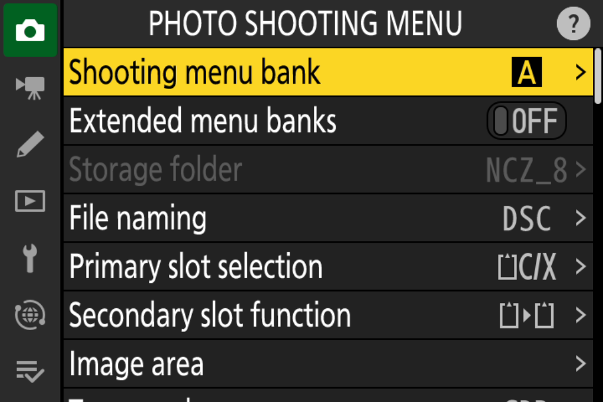
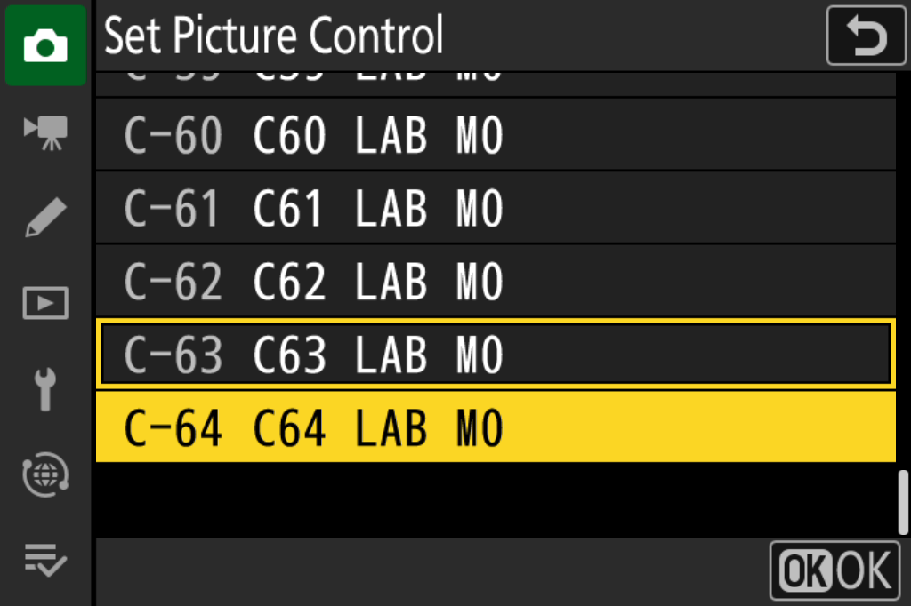
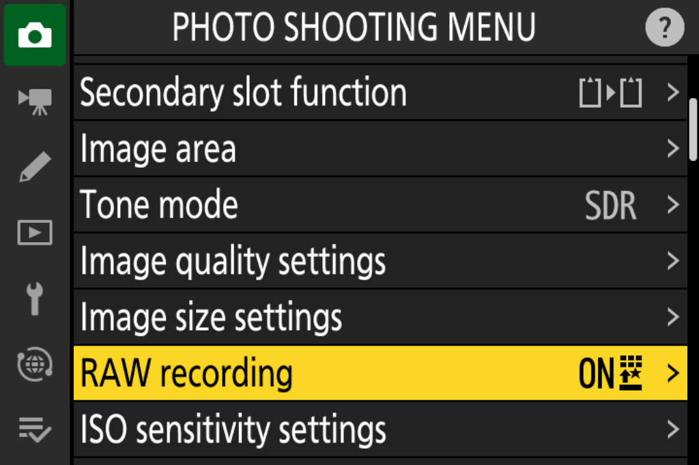
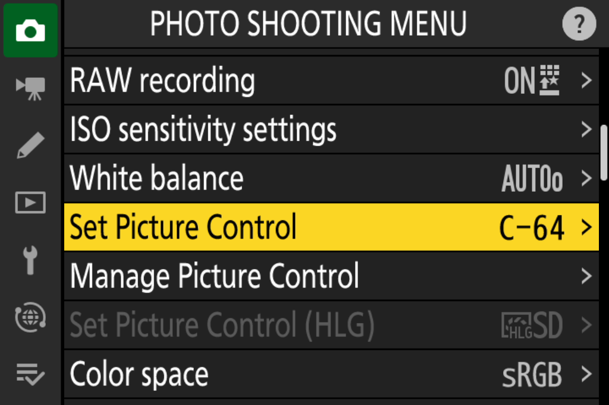
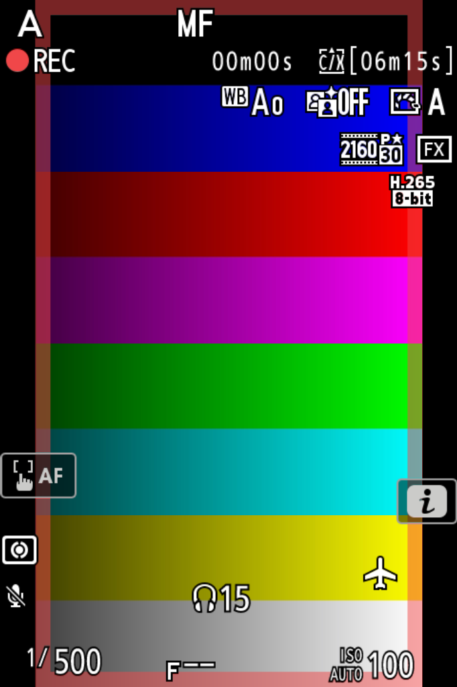
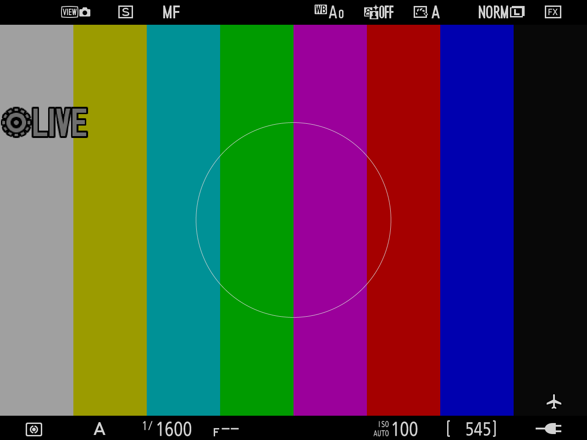

# Nikon Z8 Firmware Emulator (`z8-qemu`)

**English** | [简体中文](README.zh-CN.md)

`z8-qemu` is an experimental QEMU-based hardware emulator for **Nikon Z8 firmware C3.11** (machine `nikon-z8-bringup`), adapted from [WonderLantern/z9-qemu](https://github.com/WonderLantern/z9-qemu) and pinned to upstream QEMU `10.2.4`.

It lets you boot an extracted Z8 `MAIN` firmware image on a Linux or Windows WSL2 host, navigate native camera menus in your browser, test synthetic Live View and EVF rendering, capture single-shot RAW (`.NEF`) files onto a virtual CFexpress card, and run custom firmware experiments (such as 32/64 Picture Control slots and portrait video HUD layouts) without touching physical hardware.

> [!IMPORTANT]
> **Emulator Only — Never Flash Derived Files to a Camera**
> - This project runs entirely on your computer. It **never** connects to or flashes a physical camera.
> - Firmware files, decryption keys, and sensor dumps are **not** included; you must extract `MAIN` from your own official `Z_8_0311.bin` package.
> - Slot-expansion and overlay tools generate modified local `MAIN` binaries strictly for QEMU experiments. They are **not** valid camera update packages and must **never** be written to a real camera.

---

## Interface Preview

| Browser Console (`127.0.0.1:8788`) | Synthetic LCD Live View |
| :---: | :---: |
|  |  |
| **Native Photo Shooting Menu** | **Expanded C64 Picture Control Slots** |
|  |  |

---

## Feature Overview

| Feature | Entry Point | What Works Today | Current Scope & Limits |
| :--- | :--- | :--- | :--- |
| **Interactive Menus & Live View** | `Start-Z8.ps1` (Windows)<br>`tools/z8_run.py` (Linux/WSL) | Boots stock Z8 C3.11 into synthetic Live View; browser UI sends `MENU` and half-press shutter; supports automated headless menu round-trip checks. | Uses host MCU peers and synthetic Bayer frames rather than real CMOS/ISP hardware. |
| **Strict Bring-Up Probe** | `Test-Z8.ps1`<br>`tools/z8_bringup.py` | Runs bounded boot checks and halts immediately on any unmodeled MMIO register access. | Optional bootstrap/bus/serial/NAND fixtures are explicit test assumptions, not proof of bare-metal boot. |
| **Single-Shot NEF Capture** | `tools/z8_capture_probe.py`<br>`tools/z8_export_nefs.py` | Captures a full-resolution `8280×5520` 14-bit `.NEF` (uncompressed/packed14 or opt-in `F0` lossless14) to a virtual exFAT card and verifies decoded pixels via LibRaw. | Single post-trigger frame only; **RAW pre-release burst capture is not yet complete**. `F0` uses an upstream functional encoder rather than Nikon compression microcode (`HE`/`HE*` unsupported). |
| **C32 / C64 Picture Control Slots** | `tools/z8_slots_acceptance.py` | Expands custom Picture Control slots to **32 or 64** for both Photo and Video (`C-1`–`C-64`), including `.NP3` import, menu selection, virtual NAND save, and cold-boot restore. | Runs on a derived QEMU `MAIN` image; not enabled by default in `Start-Z8.ps1`. |
| **Portrait HUD, EVF & Lab Overlays** | `experiments/20261114/`<br>`experiments/20261111/` | Archived overlays for vertical video OSD + histogram alignment, Wave5 H.264/HEVC + Live audio models, CFexpress hotplug harnesses, and native EXMCU wake paths. | Stored as separate source overlays/patches; **not** automatically applied by the default `tools/build.py` build. |

> Looking for the camera-side **Fenestra menu, `.wlm` loadable modules, and Live Photo (`V62`) firmware**? See the companion repository: **[fenestra-z8](https://github.com/YCX81/fenestra-z8)**.

---

## Deployment & Build Guide

### 1. System Requirements

- **OS**: Linux (Ubuntu 22.04/24.04 recommended) or **Windows 11 with WSL2 (`Ubuntu`)**.
  - *Tip*: Always keep the QEMU build directory and virtual card images on the **native Linux ext4 filesystem** (e.g., `$HOME/.local/share/nikon-z8-qemu/`), not on `/mnt/c/...`, to avoid severe I/O slowdowns.
  - Native Windows builds without WSL and native macOS QEMU builds are not supported (macOS can still hold source archives and run pure-Python offline checks).
- **Packages**: Python `3.12+`, `gcc`/`clang`, `ninja-build`, `patch`, `pkg-config`, `exfatprogs`, and development headers for `glib-2.0`, `pixman-1`, `zlib`, `libfdt`, and `libjpeg`.

On Ubuntu / WSL2:

```bash
sudo apt-get update
sudo apt-get install -y build-essential ccache ninja-build patch pkg-config \
  libglib2.0-dev libpixman-1-dev zlib1g-dev libfdt-dev libjpeg-dev exfatprogs \
  python3-venv exiftool
```

### 2. Build QEMU and Synthetic Sensor Input

Clone the repository inside Linux / WSL and build the pinned QEMU `10.2.4` binary:

```bash
git clone --branch main https://github.com/YCX81/z8-qemu.git
cd z8-qemu

python3 -m venv "$HOME/.local/share/nikon-z8-qemu/venv"
source "$HOME/.local/share/nikon-z8-qemu/venv/bin/activate"

python -m pip install -r requirements.txt
python -m pip install -r requirements-capture.txt
python -m pip install -r requirements-c10.txt

# Downloads official QEMU 10.2.4, verifies SHA-256, applies the Z8 board overlay, and compiles
python tools/build.py --work-dir "$HOME/.local/share/nikon-z8-qemu/work" --jobs 4

# Generates the synthetic Bayer sensor frame at .local/input.raw
python tools/make_cmos.py
```

- If you already downloaded `qemu-10.2.4.tar.xz` (`SHA-256: 821b545b92f165e57dddccac5077d76d4d436a226595b8813ad59306bbfd0746`), pass `--archive /path/to/qemu-10.2.4.tar.xz` to `tools/build.py`.
- Verify the build without needing any Nikon firmware:

```bash
sh tests/run.sh
python tests/check_z8_machine.py \
  --qemu "$HOME/.local/share/nikon-z8-qemu/work/build/qemu-system-aarch64"
```

### 3. Prepare the Nikon Z8 C3.11 `MAIN` Image

`z8-qemu` requires the **decrypted, uncompressed `MAIN` payload** extracted from Nikon's official Z8 firmware `C3.11` update file (`Z_8_0311.bin`), placed at:

```text
.local/firmware/z8-c311-main.bin
```

| File | Exact Byte Size | SHA-256 | Notes |
| :--- | :--- | :--- | :--- |
| `Z_8_0311.bin` | `99,051,117` | `d67413c2ede6b9ce8887175f20700bd9fbad2a973a4820968c45503d15d80d96` | Official encrypted update container (**cannot** be passed directly to QEMU). |
| `z8-c311-main.bin` | `81,807,709` | `2b43a31c9de838f84b12416de4348a7004e65be07f853ec56ec2b10f3a8e3853` | Extracted from module `eg2070_0311b0.bi` after stripping the trailing 2-byte CRC. |

See [docs/firmware.md](docs/firmware.md) for details. Every launcher verifies the exact length and SHA-256 before booting and opens the original file **read-only**.

---

## Feature Usage Guide

### 1. Interactive Browser Console, Menus & Live View

#### On Windows (PowerShell wrappers calling WSL `Ubuntu`)

```powershell
# Launch interactive mode with browser UI at http://127.0.0.1:8788/
.\Start-Z8.ps1

# Run automated headless check (3 MENU <-> Live View cycles + pixel verification)
.\Start-Z8.ps1 -Headless -Seconds 360 -MenuTest -RequireLiveView
```

#### On Linux / WSL Directly

```bash
source "$HOME/.local/share/nikon-z8-qemu/venv/bin/activate"

python tools/z8_run.py \
  --firmware .local/firmware/z8-c311-main.bin \
  --qemu "$HOME/.local/share/nikon-z8-qemu/work/build/qemu-system-aarch64" \
  --raw .local/input.raw \
  --output "$HOME/.local/share/nikon-z8-qemu/runs/demo-01" \
  --port 8788
```

**How to use the web console (`http://127.0.0.1:8788/`):**
1. Open `http://127.0.0.1:8788/` in your browser and wait ~15–25 seconds for initial boot and synthetic Live View color bars to appear.
2. Click **`MENU`** to open the Nikon Z8 main menu (`PHOTO SHOOTING MENU`).
3. Click **`半按快门` (Half-Press)** followed by **`释放快门` (Release)** to exit the menu and return to Live View.
4. Click **`停止仿真` (Stop)** on the web page or press `Ctrl+C` in the terminal to cleanly shut down QEMU. Check `<output>/result.json` for structured run diagnostics.

---

### 2. Strict Hardware Bring-Up Check

Use `Test-Z8.ps1` (or `tools/z8_bringup.py`) when modifying QEMU peripheral models and testing how far stock firmware boots before hitting an unmodeled hardware register:

```powershell
# Strict mode: zero synthetic fixtures; stops on the first unknown MMIO access
.\Test-Z8.ps1

# Enable explicit bootstrap, bus-window, serial, and NAND test fixtures
.\Test-Z8.ps1 -BootstrapFixture -BusWindowFixture -SerialFixture -NandFixture
```

---

### 3. Single-Shot RAW (`.NEF`) Capture & `F0` Lossless14 Audit

`Start-Z8.ps1` only wires `MENU` and half-press shutter. To format/mount a virtual CFexpress card, navigate camera quality settings, trigger a full shutter release, and export `.NEF` files, use `tools/z8_capture_probe.py`.

| RAW Recording Menu Setup | Virtual Card Photo Playback |
| :---: | :---: |
|  |  |

#### Capture an Uncompressed / Packed14 NEF

```bash
python tools/z8_capture_probe.py \
  --firmware .local/firmware/z8-c311-main.bin \
  --qemu "$HOME/.local/share/nikon-z8-qemu/work/build/qemu-system-aarch64" \
  --raw .local/input.raw \
  --output "$HOME/.local/share/nikon-z8-qemu/runs/capture-packed14" \
  --seconds 600 --settle 10 \
  --capture-properties profiles/z8-capture-properties.json \
  --card --gpio --rtc-status --capture-selector \
  --tagged-input --capture-pixels --skip-cseq-repeat --wait-capture-work \
  --menu-actions menu,down,down,down,down,down,down,down,down,right,right,up,up,up,up,j,left,down,down,right,up,j
```

#### Capture a Lossless Compressed (`F0` 14-bit) NEF & Verify Pixels

Swap `--capture-properties` to `profiles/z8-lossless14-properties.json` (which enables `engine1540-lossless14-model=on` and `output-buffer-ownership-model=on`), then export and audit the captured `.NEF`:

```bash
RUN_DIR="$HOME/.local/share/nikon-z8-qemu/runs/capture-lossless14"

# 1. Export .NEF files from the virtual exFAT card image
python tools/z8_export_nefs.py \
  --run "$RUN_DIR" \
  --firmware .local/firmware/z8-c311-main.bin \
  --output "$RUN_DIR/nef-export"

# 2. Verify decoded LibRaw samples against the emulator's 151 producer RAM snapshot
python tools/z8_photo_audit.py \
  --manifest "$RUN_DIR/photo-audit-input.json" \
  --output "$RUN_DIR/photo-audit-result.json"
```

- Add `--nvme-trace` (requires `--card`) if you also want complete NVMe queue/completion logs in `nvme-evidence.json`.
- Note: Use `j` (not `ok`) for confirmation in `--menu-actions` with `z8_capture_probe.py`. Always use a **non-existent `--output` directory** for every run.

---

### 4. Custom Picture Control Slot Expansion (`C32` / `C64`)

Stock Z8 firmware provides 9 custom Picture Control slots (`C-1`–`C-9`). `tools/z8_slots_acceptance.py` generates a local QEMU-only derived `MAIN` that expands Photo and Video custom slots to **32 (`C-1`–`C-32`)** or **64 (`C-1`–`C-64`)** with persistent virtual NAND storage.

| Main Menu Showing `C-64` Active | Expanded `Set Picture Control` List |
| :---: | :---: |
|  |  |

```bash
WORK="$HOME/.local/share/nikon-z8-qemu/runs/c64-demo"
mkdir -p "$WORK"

# Phase 1: Create virtual NAND, import 64 Photo + 64 Video .NP3 presets, select C-64 in menu, and save
python tools/z8_slots_acceptance.py --slots 64 --phase create --gui photo \
  --firmware .local/firmware/z8-c311-main.bin \
  --qemu "$HOME/.local/share/nikon-z8-qemu/work/build/qemu-system-aarch64" \
  --raw .local/input.raw \
  --output "$WORK/01-photo-create" \
  --media "$WORK/c64-nand.img"

# Phase 2: Cold-boot a new QEMU process from the saved NAND image and verify all 128 records restore
python tools/z8_slots_acceptance.py --slots 64 --phase restore --gui photo \
  --firmware .local/firmware/z8-c311-main.bin \
  --qemu "$HOME/.local/share/nikon-z8-qemu/work/build/qemu-system-aarch64" \
  --raw .local/input.raw \
  --output "$WORK/02-photo-restore" \
  --media "$WORK/c64-nand.img" \
  --expected "$WORK/01-photo-create/expected-records.json"
```

- Change `--slots 64` to `--slots 32` for 32-slot mode.
- For independent video slot testing, copy `c64-nand.img` to a new file and run `--phase restore --gui video`, followed by `--phase restore --gui video-cold`.

---

### 5. Portrait Video HUD, EVF Viewfinder & Archived Lab Experiments

Additional hardware and UI models used alongside Fenestra Z8 development are archived under `experiments/`:

| Portrait Video Recording HUD (`90°` Upright) | Electronic Viewfinder (`EVF` Output 4, `1280×960`) |
| :---: | :---: |
|  |  |

- **`experiments/20261114/portrait-full/` — Portrait Video Layout & Histogram Fix**: Aligns vertical video shooting status icons (`REC`, timecode, resolution, codec, exposure row) and the live histogram to the native vertical photo layout (`build_overlay.py`).
- **`experiments/20261111/wave5/` — Wave5 Video Encoder & Live Audio Overlay**: QEMU source overlay and patches for rolling H.264/HEVC encoding and LPCM audio used during Live Photo firmware testing.
- **`experiments/20261111/card-hotplug/` — CFexpress Hotplug Harness**: Card presence/link properties, swap runners (`run_pull.py`, `swaprun.py`), and IRQ/MMIO/power-cut trace plugins.
- **`experiments/20261111/exmcu/` — Native EXMCU & Host-Wake**: Runs the camera's secondary `EX` microcontroller firmware directly over virtual SPI/GPIO (`native_run.py`; requires private `EX` firmware input).
- **`REA.ps1` — Reverse-Engineering CLI Wrapper**: Optional Windows wrapper invoking a local WSL Ghidra / REA installation on analysis ELF slices.

> **How to inspect experiment patches safely:** The default `tools/build.py` intentionally builds only the clean baseline `qemu/` overlay. Do **not** blindly apply every patch in `experiments/20261111/` onto a single QEMU source tree—several patches target different prepared baselines. Always test applicability on a separate copy first (e.g., `patch --dry-run -p1 < patchfile`).

---

## Precautions & Gotchas

1. **Never flash derived `MAIN` files**: Files generated by `z8_slots_acceptance.py` or `portrait-full/build_overlay.py` are unencrypted QEMU memory images, not camera firmware updates.
2. **Container vs. `MAIN`**: Passing the `99 MB` `Z_8_0311.bin` update container to `--firmware` will be rejected; extract the `81,807,709`-byte `MAIN` image first.
3. **Always use fresh `--output` directories**: Runners refuse to overwrite existing output directories or virtual card images so previous test evidence is never silently clobbered.
4. **Do not mix C32 and C64 NAND images**: Virtual NAND media (`--media`) is bound to its slot capacity (`32` vs `64`). Create a new NAND image when switching capacities.
5. **Check `result.json`, not just exit code `0`**: A process exit code of `0` only means the diagnostic harness exited cleanly; inspect `result.json` (e.g., `liveview_verified`, `menu_verified`, `slots_complete`, `pixels_verified`) to confirm feature checks passed.
6. **Keep proprietary files out of Git**: Firmware binaries, keys, virtual cards, memory dumps, and personal media must stay in `.local/` or outside the repo. Run `python -B tools/audit_publication.py` before committing to verify the tracked file inventory.

---

## Further Documentation & Credits

- **Guides & References**: [Build Details](docs/build.md) · [Firmware Input](docs/firmware.md) · [C32/C64 Slots](docs/z8-c32.md) · [RAW Capture Probe](docs/z8-capture-probe.md) · [Per-Photo & F0 Audit](docs/z8-photo-audit.md) · [Publication Policy](docs/publication.md) · [TODO](docs/TODO.md)
- **Topic Branches**: Experimental branches (`codex/raw-precapture-shared146`, `codex/z8-video-c1`, `codex/z8-orientation`, `codex/z8-heif-1602`, `codex/e7-neural-research`, etc.) hold standalone prototypes with separate boundaries; see [Topic Branch Overview](docs/publication-progress-20261015.md).
- **Upstream & Attribution**: Forked from [WonderLantern/z9-qemu](https://github.com/WonderLantern/z9-qemu) (providing the shared Expeed board model and RdWing's `nikon-expeed-lossless.h` `F0` encoder), building against [QEMU 10.2.4](https://www.qemu.org/), and using [LibRaw](https://github.com/LibRaw/LibRaw) for independent `.NEF` verification.
- **License**: `GPL-2.0-or-later`. See [COPYING](COPYING), [NOTICE.md](NOTICE.md), and [CONTRIBUTING.md](CONTRIBUTING.md).
