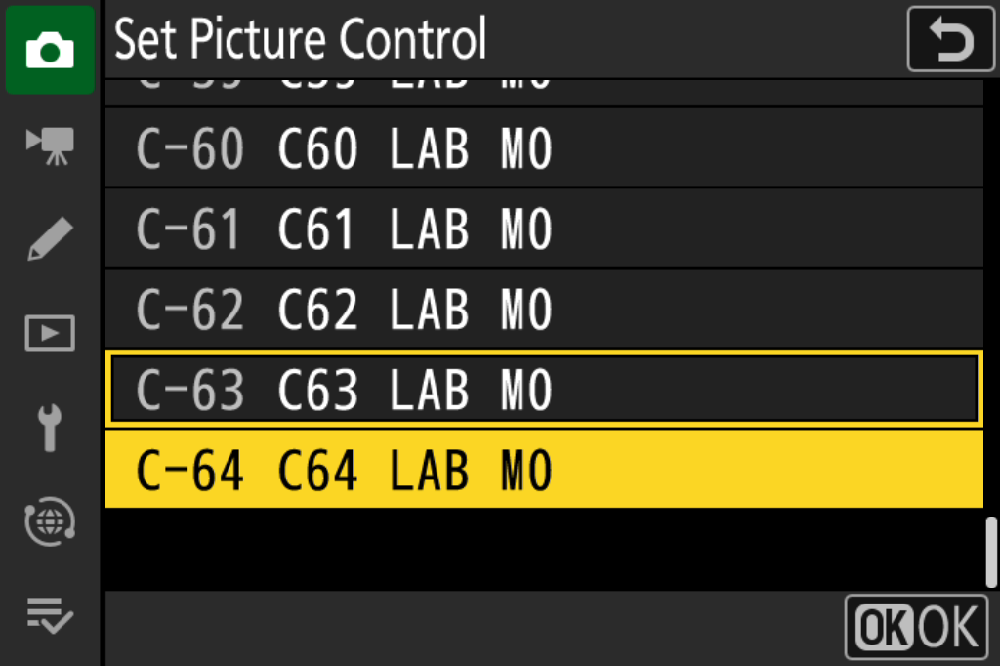
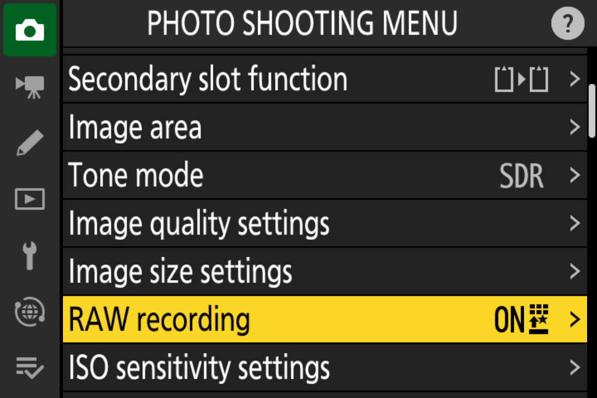
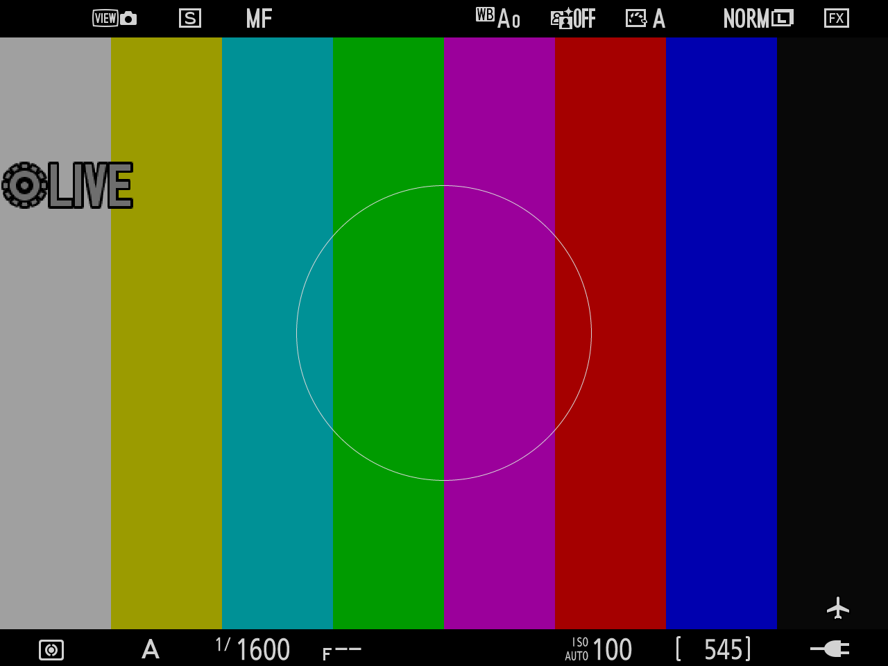

# Nikon Z8 固件模拟器 (`z8-qemu`)

[English](README.md) | **简体中文**

`z8-qemu` 是面向 **Nikon Z8（固件版本 C3.11）** 的实验性硬件模拟器（机器名 `nikon-z8-bringup`），基于 [WonderLantern/z9-qemu](https://github.com/WonderLantern/z9-qemu) 移植并固定使用上游 QEMU `10.2.4`。

你可以在电脑（Linux 或 Windows WSL2）上直接启动提取出的 Z8 原厂 `MAIN` 固件，在浏览器里操作相机菜单、查看模拟实时取景与电子取景器（EVF）画面、将单张 14-bit RAW（`.NEF`）照片写入虚拟存储卡，并在不接触真机的前提下测试各类固件扩展实验（例如 32/64 个自定义优化校准槽位、竖屏视频界面重排等）。

> [!IMPORTANT]
> **仅供电脑端仿真研究——严禁将派生文件刷入真机**
> - 本项目完全在电脑本地运行，**不会**连接实体相机，更不会执行任何刷机操作。
> - 仓库不包含尼康固件、密钥或真机传感器数据，你需要自行从官方升级包 `Z_8_0311.bin` 提取 `MAIN`。
> - 槽位扩容、竖屏重排等脚本生成的派生 `MAIN` 只是给 QEMU 加载的内存镜像，**不是相机升级包，严禁写入实体相机**。

---

## 界面一览

| 浏览器交互控制台 (`127.0.0.1:8788`) | LCD 模拟实时取景画面 |
| :---: | :---: |
|  |  |
| **原厂照片拍摄菜单** | **C64 自定义优化校准槽位扩容** |
|  |  |

---

## 功能总览

| 功能模块 | 启动入口 | 目前能做什么 | 当前限制说明 |
| :--- | :--- | :--- | :--- |
| **浏览器菜单与模拟取景** | `Start-Z8.ps1`（Windows）<br>`tools/z8_run.py`（Linux/WSL） | 启动原厂 C3.11 进入模拟彩条取景；网页按钮触发 `MENU` 进入菜单、半按快门返回取景；支持无界面自动往返测试。 | 依赖宿主侧虚拟 MCU 与合成 Bayer 图像，并非还原真实 CMOS/ISP 硬件画质。 |
| **严格启动硬件探针** | `Test-Z8.ps1`<br>`tools/z8_bringup.py` | 检查固件冷启动进度，一旦访问未建模的硬件寄存器（未知 MMIO）立即停机报错，便于补齐外设模型。 | 可选开启的 bootstrap/bus/serial/NAND 参数仅作测试假设，不代表裸机已完整驱动。 |
| **单张拍照与 NEF 导出** | `tools/z8_capture_probe.py`<br>`tools/z8_export_nefs.py` | 在虚拟 exFAT 卡上拍摄导出全尺寸 `8280×5520` 14-bit `.NEF`（支持未压缩 packed14 或手动开启 `F0` 无损压缩），并用 LibRaw 逐像素比对内存快照。 | 目前仅支持快门触发后的单张拍摄，**RAW 预拍摄（历史帧缓存）尚未完成**；`F0` 为功能性编码器，不含尼康 `HE`/`HE*` 压缩微码。 |
| **C32 / C64 优化校准槽位** | `tools/z8_slots_acceptance.py` | 将照片与视频自定义优化校准槽位从 9 个扩充至 **32 个或 64 个**（`C-1`–`C-64`），支持 `.NP3` 导入、菜单选择、虚拟 NAND 保存与重启恢复。 | 运行于单独生成的派生 `MAIN` 镜像；默认 `Start-Z8.ps1` 不会自动开启扩容。 |
| **竖屏界面、EVF 与扩展实验** | `experiments/20261114/`<br>`experiments/20261111/` | 收录竖屏视频 OSD 与直方图对齐补丁、Wave5 视频编码与 Live 音频模型、CFexpress 热插拔测试台、以及原生 EXMCU 唤醒源码。 | 作为独立实验补丁归档，默认 `tools/build.py` **不会**自动打入主构建。 |

> 如果你想找相机端的 **Fenestra 扩展菜单、`.wlm` 模块开发 SDK 以及 Live Photo（实况照片 `V62`）固件源码**，请前往配套仓库：**[fenestra-z8](https://github.com/YCX81/fenestra-z8)**。

---

## 环境部署与编译

### 1. 环境要求

- **操作系统**：Linux（推荐 Ubuntu 22.04 / 24.04）或 **Windows 11 + WSL2（`Ubuntu` 发行版）**。
  - **强烈建议**：把编译工作目录和虚拟存储卡放在 **WSL/Linux 原生 ext4 文件系统**下（如 `$HOME/.local/share/nikon-z8-qemu/`），不要放在 `/mnt/c/...` 挂载盘上，否则大量小文件读写会非常慢。
  - 不支持原生 Windows（非 WSL）或 macOS 直接编译整机 QEMU（macOS 可用于代码归档与离线脚本检查）。
- **系统依赖**：Python `3.12+`、`gcc`/`clang`、`ninja-build`、`patch`、`pkg-config`、`exfatprogs`、`exiftool`，以及 `glib-2.0`、`pixman-1`、`zlib`、`libfdt`、`libjpeg` 开发头文件。

在 Ubuntu / WSL2 中一次性安装依赖：

```bash
sudo apt-get update
sudo apt-get install -y build-essential ccache ninja-build patch pkg-config \
  libglib2.0-dev libpixman-1-dev zlib1g-dev libfdt-dev libjpeg-dev exfatprogs \
  python3-venv exiftool
```

### 2. 编译 QEMU 与生成模拟传感器输入

在 Linux / WSL2 终端中克隆仓库并执行构建：

```bash
git clone --branch main https://github.com/YCX81/z8-qemu.git
cd z8-qemu

python3 -m venv "$HOME/.local/share/nikon-z8-qemu/venv"
source "$HOME/.local/share/nikon-z8-qemu/venv/bin/activate"

python -m pip install -r requirements.txt
python -m pip install -r requirements-capture.txt
python -m pip install -r requirements-c10.txt

# 自动下载官方 QEMU 10.2.4 源码包并校验 SHA-256，打入 Z8 板级模型后编译
python tools/build.py --work-dir "$HOME/.local/share/nikon-z8-qemu/work" --jobs 4

# 在 .local/input.raw 生成合成 Bayer 传感器输入图像
python tools/make_cmos.py
```

- 如果本地已提前下载好 `qemu-10.2.4.tar.xz`（`SHA-256: 821b545b92f165e57dddccac5077d76d4d436a226595b8813ad59306bbfd0746`），可通过 `--archive /path/to/qemu-10.2.4.tar.xz` 直接指定，省去下载步骤。
- 编译完成后，可以先跑一遍无需尼康固件的自检：

```bash
sh tests/run.sh
python tests/check_z8_machine.py \
  --qemu "$HOME/.local/share/nikon-z8-qemu/work/build/qemu-system-aarch64"
```

### 3. 准备私有 Z8 C3.11 `MAIN` 固件

模拟器需要你自行从官方 Z8 `C3.11` 升级包（`Z_8_0311.bin`）中解密提取出 **`MAIN` 主程序镜像**，并放置在仓库下的：

```text
.local/firmware/z8-c311-main.bin
```

| 文件名 | 精确字节数 | SHA-256 校验值 | 说明 |
| :--- | :--- | :--- | :--- |
| `Z_8_0311.bin` | `99,051,117` | `d67413c2ede6b9ce8887175f20700bd9fbad2a973a4820968c45503d15d80d96` | 尼康官方升级包容器（加密封装，**不能**直接喂给模拟器）。 |
| `z8-c311-main.bin` | `81,807,709` | `2b43a31c9de838f84b12416de4348a7004e65be07f853ec56ec2b10f3a8e3853` | 从 `eg2070_0311b0.bi` 模块提取并去掉末尾 2 字节 CRC 后的 `MAIN` 镜像。 |

详见 [docs/firmware.md](docs/firmware.md)。所有启动脚本都会严格核对字节长度和 SHA-256，并以**只读方式**打开原始文件。

---

## 各功能详细使用说明

### 1. 浏览器交互控制台、原厂菜单与模拟取景

#### Windows 用户（PowerShell 一键调用 WSL `Ubuntu`）

```powershell
# 启动网页交互模式，浏览器打开 http://127.0.0.1:8788/
.\Start-Z8.ps1

# 无界面自动化测试（自动执行 3 轮“进入菜单 -> 半按返回取景”并校验画面像素）
.\Start-Z8.ps1 -Headless -Seconds 360 -MenuTest -RequireLiveView
```

#### Linux / WSL2 命令行直接启动

```bash
source "$HOME/.local/share/nikon-z8-qemu/venv/bin/activate"

python tools/z8_run.py \
  --firmware .local/firmware/z8-c311-main.bin \
  --qemu "$HOME/.local/share/nikon-z8-qemu/work/build/qemu-system-aarch64" \
  --raw .local/input.raw \
  --output "$HOME/.local/share/nikon-z8-qemu/runs/demo-01" \
  --port 8788
```

**操作方法：**
1. 在浏览器访问 `http://127.0.0.1:8788/`，首次启动需等待约 15–25 秒，画面会显示模拟彩条实时取景与曝光状态栏。
2. 点击网页上的 **`MENU`** 按钮即可打开原厂菜单（`PHOTO SHOOTING MENU`）。
3. 依次点击 **`半按快门`** 和 **`释放快门`** 即可退出菜单回到实时取景。
4. 结束时点击网页上的 **`停止仿真`** 或在终端按 `Ctrl+C`，运行日志与自检结果保存在输出目录的 `result.json` 中。

---

### 2. 严格硬件启动诊断（`Test-Z8`）

当你修改底层外设模型、想检查原厂固件在无外部辅助时能跑到哪一步时使用：

```powershell
# 默认严格模式：不开启任何假设性外设，遇到第一个未建模寄存器读写即停机
.\Test-Z8.ps1

# 显式开启引导、总线窗口、串口与 NAND 辅助夹具进行有界诊断
.\Test-Z8.ps1 -BootstrapFixture -BusWindowFixture -SerialFixture -NandFixture
```

---

### 3. 单张 RAW（`.NEF`）拍照导出与 `F0` 无损压缩校验

`Start-Z8.ps1` 只接了 `MENU` 和半按快门；若要挂载虚拟存储卡、修改画质菜单并全按快门拍出 `.NEF` 文件，请使用 `tools/z8_capture_probe.py`。

| 菜单中开启 RAW 记录 | 虚拟卡拍摄后的回放界面 |
| :---: | :---: |
|  |  |

#### 拍摄普通未压缩（Packed14）NEF

```bash
python tools/z8_capture_probe.py \
  --firmware .local/firmware/z8-c311-main.bin \
  --qemu "$HOME/.local/share/nikon-z8-qemu/work/build/qemu-system-aarch64" \
  --raw .local/input.raw \
  --output "$HOME/.local/share/nikon-z8-qemu/runs/capture-packed14" \
  --seconds 600 --settle 10 \
  --capture-properties profiles/z8-capture-properties.json \
  --card --gpio --rtc-status --capture-selector \
  --tagged-input --capture-pixels --skip-cseq-repeat --wait-capture-work \
  --menu-actions menu,down,down,down,down,down,down,down,down,right,right,up,up,up,up,j,left,down,down,right,up,j
```

#### 拍摄 14-bit 无损压缩（`F0`）NEF 并逐像素校验

只需将 `--capture-properties` 换成 `profiles/z8-lossless14-properties.json`（开启 `engine1540-lossless14-model` 与输出缓冲所有权检查），跑完后导出并审计 `.NEF`：

```bash
RUN_DIR="$HOME/.local/share/nikon-z8-qemu/runs/capture-lossless14"

# 1. 从虚拟 exFAT 存储卡镜像中导出 .NEF 照片
python tools/z8_export_nefs.py \
  --run "$RUN_DIR" \
  --firmware .local/firmware/z8-c311-main.bin \
  --output "$RUN_DIR/nef-export"

# 2. 用 LibRaw 解码 .NEF，与模拟器内部 151 单元 RAM 原始像素逐样本比对
python tools/z8_photo_audit.py \
  --manifest "$RUN_DIR/photo-audit-input.json" \
  --output "$RUN_DIR/photo-audit-result.json"
```

- 如需同时记录底层 NVMe 队列和写卡完成日志，可在拍摄命令中加 `--nvme-trace`（必须配合 `--card`）。
- 注意：`z8_capture_probe.py` 的 `--menu-actions` 中确认键写为 `j`（不接受 `ok` 别名），且每次运行的 `--output` 必须是**尚未存在的新目录**。

---

### 4. 自定义优化校准槽位扩容（`C32` / `C64`）

Z8 原厂仅提供 `C-1`–`C-9` 共 9 个自定义优化校准槽位。`tools/z8_slots_acceptance.py` 会在本地生成派生的仿真 `MAIN`，将照片和视频槽位分别扩容到 **32 个（`C-1`–`C-32`）** 或 **64 个（`C-1`–`C-64`）**，并把导入的 `.NP3` 参数持久化保存到虚拟 NAND。

| 主菜单显示当前已选 `C-64` | 展开后的 `C-60`–`C-64` 槽位列表 |
| :---: | :---: |
|  |  |

```bash
WORK="$HOME/.local/share/nikon-z8-qemu/runs/c64-demo"
mkdir -p "$WORK"

# 阶段 1：新建虚拟 NAND 介质，导入照片+视频各 64 个 .NP3 预设，在菜单中选中 C-64 并保存
python tools/z8_slots_acceptance.py --slots 64 --phase create --gui photo \
  --firmware .local/firmware/z8-c311-main.bin \
  --qemu "$HOME/.local/share/nikon-z8-qemu/work/build/qemu-system-aarch64" \
  --raw .local/input.raw \
  --output "$WORK/01-photo-create" \
  --media "$WORK/c64-nand.img"

# 阶段 2：冷启动全新 QEMU 进程，验证从虚拟 NAND 完整恢复全部 128 条记录及选中状态
python tools/z8_slots_acceptance.py --slots 64 --phase restore --gui photo \
  --firmware .local/firmware/z8-c311-main.bin \
  --qemu "$HOME/.local/share/nikon-z8-qemu/work/build/qemu-system-aarch64" \
  --raw .local/input.raw \
  --output "$WORK/02-photo-restore" \
  --media "$WORK/c64-nand.img" \
  --expected "$WORK/01-photo-create/expected-records.json"
```

- 如需测试 32 槽位，把 `--slots 64` 改为 `--slots 32` 即可。
- 如需继续测试视频独立槽位，先复制一份保存好的 `c64-nand.img`，再依次运行 `--phase restore --gui video` 与 `--phase restore --gui video-cold`。

---

### 5. 竖屏视频布局、EVF 电子取景器与归档实验（`experiments/`）

配合 Fenestra Z8 开发的扩展外设与界面实验归档在 `experiments/` 目录下：

| 竖屏视频录制界面（旋转竖看效果） | EVF 电子取景器界面（Output 4，`1280×960`） |
| :---: | :---: |
|  |  |

- **`experiments/20261114/portrait-full/` —— 竖屏视频布局与直方图修复**：把竖拍视频时的录制状态（`REC`、时间码、分辨率、编码格式、底部曝光栏）和实时直方图对齐到原生竖屏拍照坐标（`build_overlay.py`），解决原厂 16:9 竖屏直方图溢出问题。
- **`experiments/20261111/wave5/` —— Wave5 硬件编码器与 Live 音频模型**：用于 Live Photo（实况照片）仿真的 H.264/HEVC 循环编码与 LPCM 音频补丁。
- **`experiments/20261111/card-hotplug/` —— CFexpress 存储卡热插拔诊断**：模拟拔插卡、换卡测试脚本（`run_pull.py`、`swaprun.py`）以及中断/断电观察插件。
- **`experiments/20261111/exmcu/` —— 原生 EX 副控芯片与电源唤醒研究**：在 QEMU 中直接运行副控芯片 `EX` 固件进行开机与待机唤醒交互（需自行准备私有 `EX` 固件输入）。
- **`REA.ps1` —— 逆向分析辅助脚本**：Windows 下调用 WSL 内已安装的 Ghidra / REA 工具链分析本地固件切片。

> **实验补丁使用提示**：默认 `tools/build.py` 只编译根目录稳定的 `qemu/` 模型，**不会**自动打入 `experiments/` 下的补丁。不同实验补丁针对各自的源码基线，请勿在同一份工作树里把所有 `.patch` 顺序硬打；使用前先在独立副本中执行 `patch --dry-run -p1 < 补丁文件` 检查上下文。

---

## 注意事项与常见坑

1. **严禁拿派生 `MAIN` 刷机**：`z8_slots_acceptance.py`、`portrait-full` 等生成的 `.main` 只是模拟器内存加载文件，绝对不能写入实体相机。
2. **区分升级包容器与 `MAIN`**：`99 MB` 的 `Z_8_0311.bin` 是外层加密容器，直接传给 `--firmware` 会报错拒绝，必须先解出 `81,807,709` 字节的 `z8-c311-main.bin`。
3. **每次运行使用全新 `--output` 目录**：为了防止误删覆盖之前的测试产物，所有运行脚本遇到已存在的输出目录或卡镜像都会主动报错退出。
4. **C32 与 C64 虚拟 NAND 不能混用**：`--media` 指定的 NAND 镜像与槽位容量（`32` 或 `64`）严格绑定，没有原地升降级转换工具，切换容量请新建介质文件。
5. **不要只看退出码 `0`**：命令行返回 `0` 仅代表诊断进程正常走完，具体功能是否通过请打开输出目录下的 `result.json` 核对（如 `liveview_verified`、`menu_verified`、`slots_complete`、`pixels_verified` 等字段）。
6. **切勿向 Git 提交私有文件**：原厂固件、密钥、生成的 `.main`、虚拟卡镜像、内存转储与私人素材必须留在 `.local/` 或仓库外。提交代码前请运行 `python -B tools/audit_publication.py` 校验发布清单。

---

## 延伸阅读与致谢

- **专题技术文档**：[编译细节](docs/build.md) · [固件准备](docs/firmware.md) · [C32/C64 槽位设计](docs/z8-c32.md) · [RAW 拍摄诊断](docs/z8-capture-probe.md) · [逐照片与 F0 审计](docs/z8-photo-audit.md) · [发布边界说明](docs/publication.md) · [功能待办 TODO](docs/TODO.md)
- **其他研究分支**：RAW 预拍历史帧（`codex/raw-precapture-shared146`）、视频 C1（`codex/z8-video-c1`）、视频方向（`codex/z8-orientation`）、HEIF 静态编码（`codex/z8-heif-1602`）、E7 神经网络解析（`codex/e7-neural-research`）等独立原型保存在各自的 Git 分支中，详见[分支进度概览](docs/publication-progress-20261015.md)。
- **上游与参考来源**：分叉自 [WonderLantern/z9-qemu](https://github.com/WonderLantern/z9-qemu)（提供共享板级模型及保留 RdWing 署名的 `nikon-expeed-lossless.h` `F0` 无损编码器），固定构建上游 [QEMU 10.2.4](https://www.qemu.org/)，并使用 [LibRaw](https://github.com/LibRaw/LibRaw) 独立校验 `.NEF` 解码结果。
- **开源许可**：沿用上游 `GPL-2.0-or-later` 许可，详见 [COPYING](COPYING)、[NOTICE.md](NOTICE.md) 与 [CONTRIBUTING.md](CONTRIBUTING.md)。
