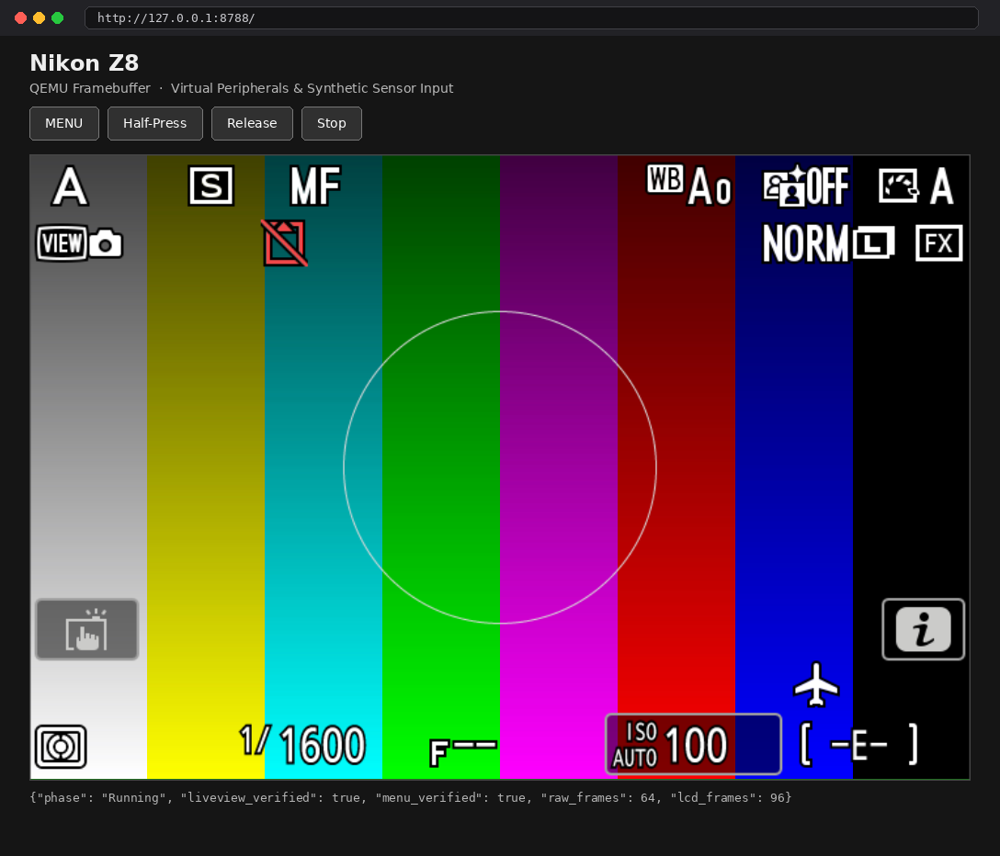
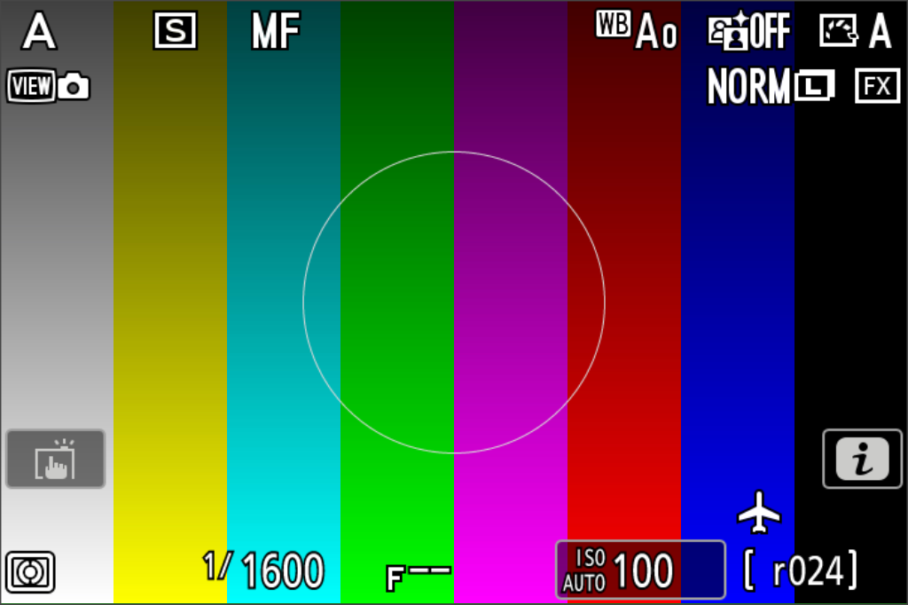
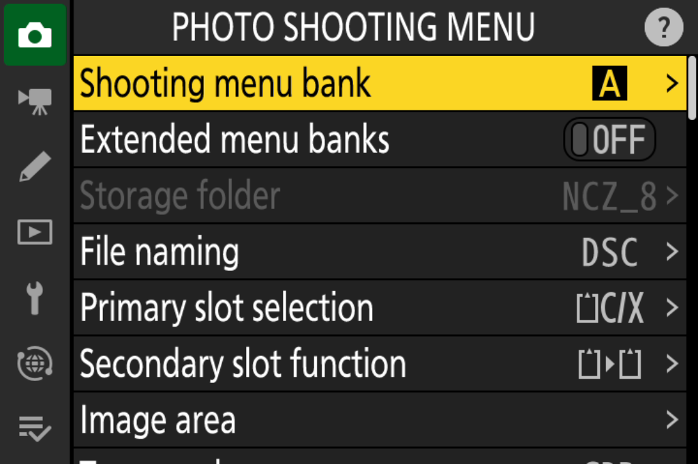
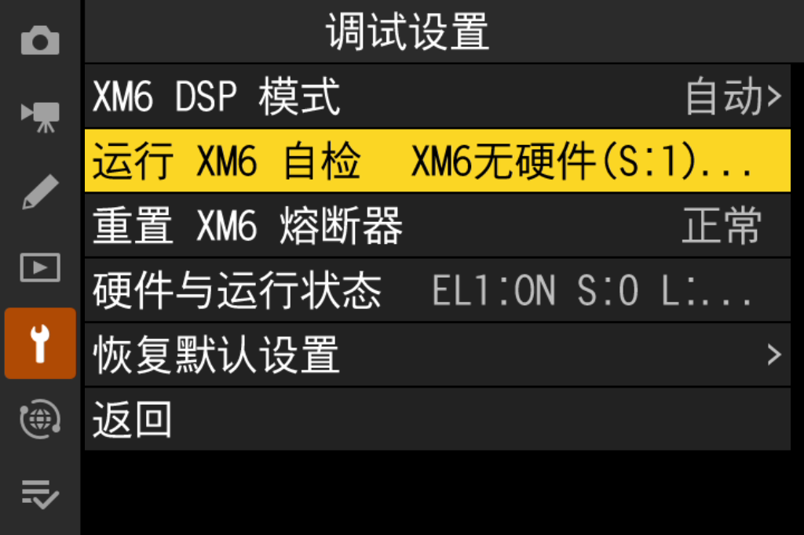
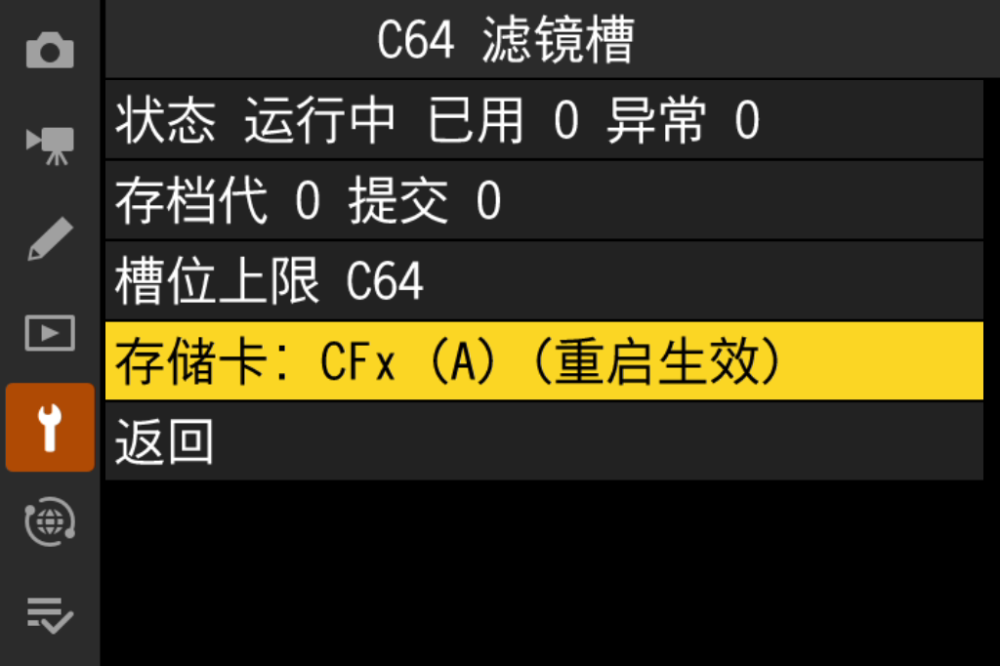
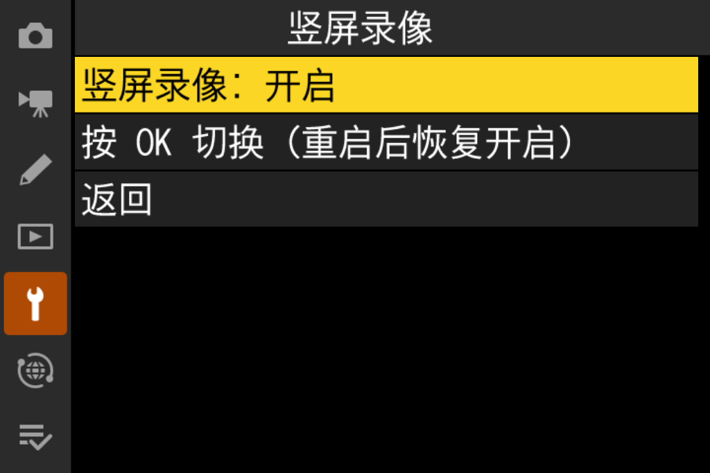

# Nikon Z8 固件模拟器 (`z8-qemu`)

[English](README.md) | **简体中文**

> **文档导航**：[V71.7-r7 详细功能与仿真验证手册（简体中文）](docs/features-and-usage.zh-CN.md) · [Detailed Feature & V71.7-r7 Emulation Reference (EN)](docs/features-and-usage.md) · [配套机身端插件仓库 `fenestra-z8`](https://github.com/YCX81/fenestra-z8)

`z8-qemu` 是面向 **Nikon Z8（固件版本 C3.11）** 的实验性硬件模拟器（机器名 `nikon-z8-bringup`），基于 [WonderLantern/z9-qemu](https://github.com/WonderLantern/z9-qemu) 移植并固定使用上游 QEMU `10.2.4`。

你可以在电脑（Linux 或 Windows WSL2）上直接启动提取出的 Z8 原厂 `MAIN` 固件，在浏览器里操作相机菜单、查看模拟实时取景画面、将单张 14-bit RAW（`.NEF`）照片写入虚拟存储卡，并在不接触真机的前提下整机仿真验证 **Fenestra `V71.7-r7`（`Z8-v71.7r7-LutPreview-362ee2a5`，内部 `04.06.p0`，Bootguard `0x8394568f`）** 全生态——包括原厂照片拍摄菜单第 47 项实时 3D LUT 预览、528 KiB L2 预烘焙 YCbCr LUT、EXPEED 7 CEVA-XM6 硬件 DSP 诊断与回退、纯净 7 行 `Fenestra` 及全部 5 款内置三语 `.wlm` 插件（`filmsim`、`livephoto`、`lut`、`slotcard`、`portrait`）。

> [!IMPORTANT]
> **仅供电脑端仿真研究——严禁将派生文件刷入真机**
> - 本项目完全在电脑本地运行，**不会**连接实体相机，更不会执行任何刷机操作。
> - 仓库**不包含**尼康固件、密钥、真机传感器数据、预编译 Fenestra 固件或提取资产（如 `ZF_GRAIN.BIN`），你需要自行从官方升级包 `Z_8_0311.bin` 提取 `MAIN`。
> - 槽位扩容、竖屏重排等脚本生成的派生 `MAIN` 只是给 QEMU 加载的内存镜像，**不是相机升级包，严禁写入实体相机**。

---

## 界面一览

### 核心硬件仿真与原厂菜单

| 浏览器交互控制台 (`127.0.0.1:8788`) | LCD 模拟实时取景画面 |
| :---: | :---: |
|  |  |
| **原厂照片拍摄菜单** | **C64 自定义优化校准槽位扩容** |
|  |  |

### `V71.7-r7` 整机仿真验证（`#19-r7` 14/14 PASS & `#20-r7` 13/13 PASS）

| 纯净 7 行 `Fenestra` 主菜单 | `插件管理`（全部 5 款内置 `.wlm` 插件） |
| :---: | :---: |
|  |  |
| **照片拍摄菜单第 47 项（`选择 LUT`）** | **原生 3D LUT 分类浏览（`FENESTRA/LUTS/`）** |
|  |  |
| **分页浏览 `.cube` 文件列表** | **3D LUT 已载入状态显示** |
|  |  |
| **实时取景 3D LUT 生效画面** | **`3D LUT 调色` 插件（`lut.wlm`）主菜单** |
|  |  |
| **`胶片模拟 / HDF`（`filmsim.wlm`）主菜单** | **`filmsim.wlm` 调试设置与 XM6 DSP 子页** |
|  |  |
| **EXPEED 7 CEVA-XM6 硬件 DSP 诊断读数** | **`实况照片`（`livephoto.wlm`）主菜单** |
|  |  |
| **双卡 `C64 滤镜槽` 插件（`slotcard.wlm`）** | **`竖屏录像` 运行期开关插件（`portrait.wlm`）** |
|  |  |

---

## 功能总览

| 功能模块 | 启动入口 | 目前能做什么 | 当前限制说明 |
| :--- | :--- | :--- | :--- |
| **浏览器菜单与模拟取景** | `Start-Z8.ps1`（Windows）<br>`tools/z8_run.py`（Linux/WSL） | 启动原厂 C3.11 进入模拟彩条取景；网页按钮触发 `MENU` 进入菜单、半按快门返回取景；支持无界面自动往返测试。 | 依赖宿主侧虚拟 MCU 与合成 Bayer 图像，并非还原真实 CMOS/ISP 硬件画质。 |
| **`V71.7-r7` 整机仿真与 5 插件验证** | 虚拟 exFAT 卡 + 整机 `MAIN`<br>（配套 [`fenestra-z8`](https://github.com/YCX81/fenestra-z8)） | 整机验证纯净 7 行 `Fenestra`、全部 5 款三语 `.wlm` 插件（`filmsim`/`livephoto`/`lut`/`slotcard`/`portrait`）、照片菜单第 47 项流式 `.cube` LUT + 528 KiB 预烘焙 LUT + Movie `0 B` 挂起 + 重启恢复/清除（`#19-r7` 14/14、`#20-r7` 13/13 PASS）、XM6 自检/回退、`0-diff` `.NEF` 与 EVF Pool #6 内存边界。 | 仓库不分发集成固件、`ZF_GRAIN.BIN` 或密钥；QEMU 仅建模 `1024×682` LCD 且无物理 XM6 硅片；`V71.7-r7` 标记为 **`physical_camera_verified = false`**。 |
| **严格启动硬件探针** | `Test-Z8.ps1`<br>`tools/z8_bringup.py` | 检查固件冷启动进度，一旦访问未建模的硬件寄存器（未知 MMIO）立即停机报错。 | 可选开启的 bootstrap/bus/serial/NAND 参数仅作测试假设，不代表裸机已完整驱动。 |
| **单张拍照与 NEF 导出** | `tools/z8_capture_probe.py`<br>`tools/z8_export_nefs.py` | 在虚拟 exFAT 卡上拍摄导出全尺寸 `8280×5520` 14-bit `.NEF`（packed14 或手动开启 `F0` 无损压缩），并用 LibRaw 逐像素比对内存快照。 | 仅支持快门触发后单张拍摄，**RAW 预拍摄尚未完成**；不含尼康 `HE`/`HE*` 压缩微码。 |
| **C32 / C64 优化校准槽位** | `tools/z8_slots_acceptance.py` | 将照片与视频自定义优化校准槽位从 9 个扩充至 **32 或 64 个**（`C-1`–`C-64`），支持 `.NP3` 导入、菜单选择、虚拟 NAND 保存与冷重启恢复。 | 运行于派生 `MAIN` 镜像；默认 `Start-Z8.ps1` 不自动开启。 |
| **竖屏界面、EVF 与扩展实验** | `experiments/20261114/`<br>`experiments/20261111/` | 收录竖屏视频 OSD 与直方图对齐补丁、Wave5 视频编码与 Live 音频模型、CFexpress 热插拔测试台、以及原生 EXMCU 唤醒源码。 | 默认 `tools/build.py` **仅构建根目录 `qemu/` 模型，不会自动打入 `experiments/` 下的补丁**。 |

---

## `V71.7-r7` 整机仿真验证要点（配套 `fenestra-z8`）

在最新一轮联合验收中，`z8-qemu` 整机引导基于 Z8 `C3.11`（内部标识 `04.06.p0`、Bootguard Build ID `0x8394568f`）的 **`V71.7-r7`（`Z8-v71.7r7-LutPreview-362ee2a5`）** 固件与 7 文件虚拟 exFAT 存储卡：

- **虚拟 exFAT 卡 7 个核心交付文件**：`STARTUP-Z8.0`（`64 B`）、`filmsim.wlm`（`32,540 B`）、`livephoto.wlm`（`15,860 B`）、`lut.wlm`（`15,624 B`）、`slotcard.wlm`（`56,552 B`）、`portrait.wlm`（`7,348 B`）、`ZF_GRAIN.BIN`（`27,588 B`，用户自备），外加可选 `FENESTRA/LUTS/<分类>/*.cube` 或 `FENESTRA/*.cube`。
- **`#19-r7`（14/14 PASS，`z8_unk = 0`，`panic = 0`）**：核验纯净 7 行 `Fenestra`、全部 5 款三语 `.wlm` 插件（0 缺字）及统一 `调试设置` 子页、XM6 自检/持久化/优雅回退 ARM NEON。
- **`#20-r7`（13/13 PASS，`z8_unk = 0`，`panic = 0`）**：核验照片拍摄菜单第 47 项流式 `.cube` LUT 浏览与加载、Layer 0 **528 KiB L2 预烘焙 `64×64×33` YCbCr LUT**（零堆增长，Class `0x24` 冻结于 `0xE8C000`）、45.4MP JPEG 调色 + `0-diff` `.NEF`、视频模式 `pool_suspend`（`0 B`）以及冷重启自动恢复与清除。
- **配套离线验证**：CEVA-XM6 `dcli.exe` 51/51 PASS（`0-diff`）、0-Q-Spill 1,114 函数 0 spill、Host ASan+UBSan 全套及 6 套 ARM64/Unicorn 套件全通过（覆盖 `r7` 四项流畅度根修：XM6 锁前去竞争、反向 `Layer 0 → Live` 单通道共享、528 KiB 烘焙 LUT 与快门后 45MP 顺延）。

> [!WARNING]
> **QEMU 仿真边界与实机验收状态（`V71.7-r7`：`physical_camera_verified = false`）**
> 1. `z8-qemu` 仅建模 **`1024×682` LCD** 扫描输出（无物理 `1280×960` EVF 面板及物理 CEVA-XM6 硅片），模拟取景约 24 fps 静态彩条且 Wave5 同步完成（`avg_wait = 0`）。
> 2. `V71.1–V71.6` 实体 Nikon Z8 的实拍与 USB 取证驱动了 `r7` 四项根修；**`V71.7-r7`（`362ee2a5`）在真机刷写复测 EVF/背屏帧率、XM6 回退率与实拍 Live `.MOV` 帧率前，明确标记为 `physical_camera_verified = false`**。

---

## 环境部署、编译与使用速览

```bash
# 1. 安装依赖（Ubuntu / WSL2，工作目录请放在 Linux 原生 ext4）
sudo apt-get update && sudo apt-get install -y build-essential ccache ninja-build \
  patch pkg-config libglib2.0-dev libpixman-1-dev zlib1g-dev libfdt-dev libjpeg-dev \
  exfatprogs python3-venv exiftool

# 2. 编译固定版本的 QEMU 10.2.4 与合成 Bayer 输入
git clone --branch main https://github.com/YCX81/z8-qemu.git && cd z8-qemu
python3 -m venv "$HOME/.local/share/nikon-z8-qemu/venv"
source "$HOME/.local/share/nikon-z8-qemu/venv/bin/activate"
python -m pip install -r requirements.txt -r requirements-capture.txt -r requirements-c10.txt
python tools/build.py --work-dir "$HOME/.local/share/nikon-z8-qemu/work" --jobs 4
python tools/make_cmos.py
sh tests/run.sh
```

- 将自行从官方 `Z_8_0311.bin`（`99,051,117 B`）提取的 `81,807,709 B` 原厂 `MAIN` 放于 `.local/firmware/z8-c311-main.bin`。
- Windows 下可直接运行 `.\Start-Z8.ps1`（浏览器访问 `http://127.0.0.1:8788/`）或 `.\Test-Z8.ps1`；单张 `.NEF` 拍摄与 `F0` 无损审计、C32/C64 NAND 四阶段验收及 `experiments/` 补丁基线规则，请参阅 **[V71.7-r7 详细功能与仿真验证手册（简体中文）](docs/features-and-usage.zh-CN.md)**。
- 提交代码前请运行 `python -B tools/audit_publication.py` 核对发布清单，严禁提交原厂固件、密钥或 `ZF_GRAIN.BIN`。

---

## 延伸阅读与致谢

- **综合手册**：[V71.7-r7 详细功能与仿真验证手册（简体中文）](docs/features-and-usage.zh-CN.md) · [Detailed Feature & V71.7-r7 Emulation Reference (EN)](docs/features-and-usage.md)
- **专题技术文档**：[编译细节](docs/build.md) · [固件准备](docs/firmware.md) · [C32/C64 槽位设计](docs/z8-c32.md) · [RAW 拍摄诊断](docs/z8-capture-probe.md) · [逐照片与 F0 审计](docs/z8-photo-audit.md) · [发布边界说明](docs/publication.md)
- **上游与开源许可**：分叉自 [WonderLantern/z9-qemu](https://github.com/WonderLantern/z9-qemu)，固定构建 [QEMU 10.2.4](https://www.qemu.org/)，使用 [LibRaw](https://github.com/LibRaw/LibRaw)；采用 `GPL-2.0-or-later` 许可（[COPYING](COPYING)、[NOTICE.md](NOTICE.md)）。
