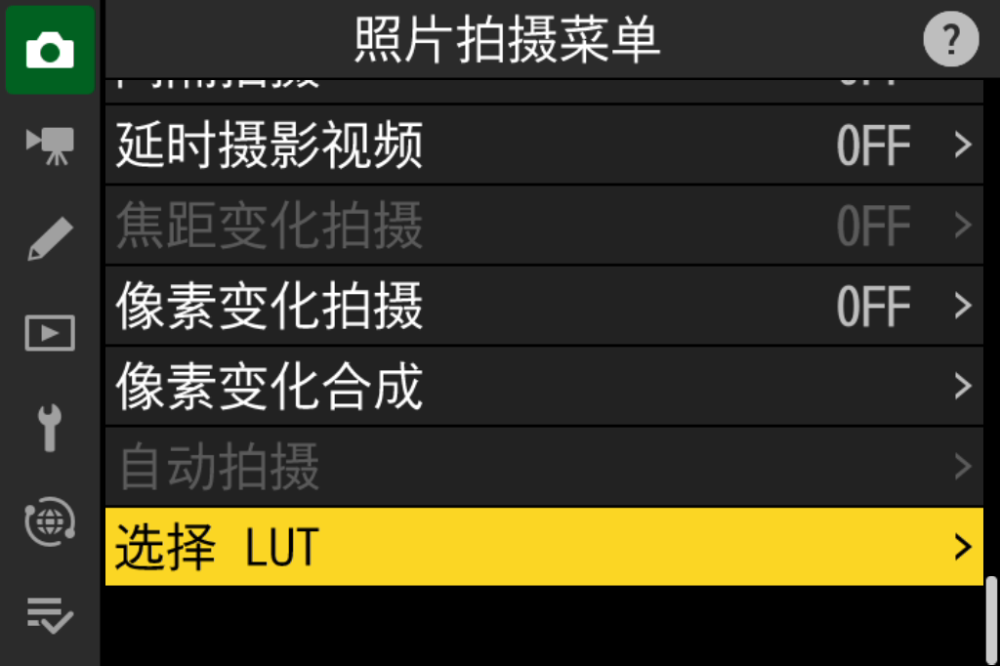
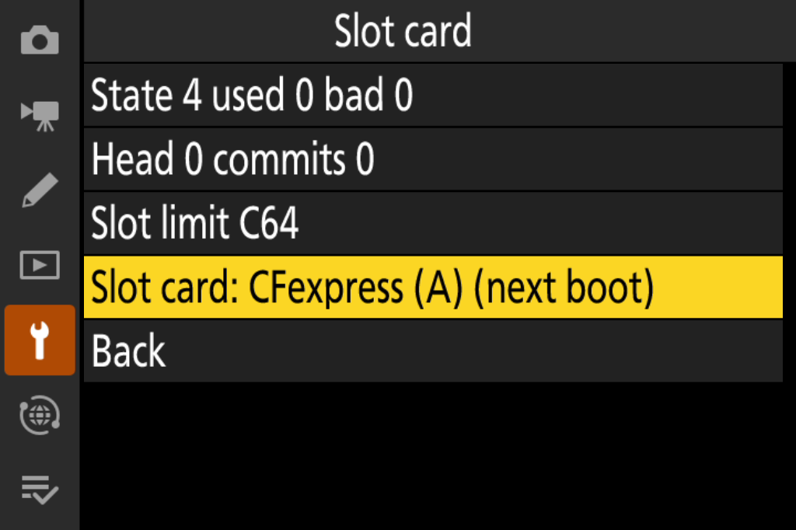
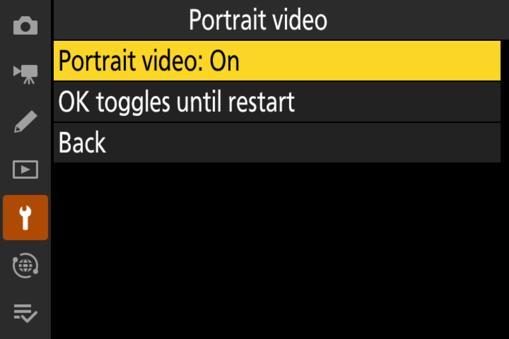

# Nikon Z8 QEMU (`z8-qemu`) Feature & V71.7-r7 Emulation Reference

**English** | [简体中文](features-and-usage.zh-CN.md) | [Back to README](../README.md)

This document is the complete operational and verification reference for **`z8-qemu`** (branch `main`, pinned to upstream QEMU `10.2.4`), covering both:

1. **Core `z8-qemu` Hardware Emulation Workflows** — stock Nikon Z8 `C3.11` bring-up, interactive menus, synthetic Live View, `C32`/`C64` virtual NAND acceptance, single-shot `.NEF` (`packed14` & opt-in `F0` lossless14) pixel auditing, archived `experiments/` overlays (Wave5, CFexpress hotplug, EXMCU, Portrait HUD), and publication auditing.
2. **`V71.7-r7` (`Z8-v71.7r7-LutPreview-362ee2a5`) Whole-Guest Firmware & 5-Plugin Verification** — how `z8-qemu` verifies the companion **[fenestra-z8](https://github.com/YCX81/fenestra-z8)** `V71.7-r7` integrated firmware (`04.06.p0`, Bootguard `0x8394568f`) and virtual exFAT card: clean 7-row `Fenestra`, native Photo Shooting Menu Row 47 streaming `.cube` 3D LUT + 528 KiB L2 baked LUT, EXPEED 7 CEVA-XM6 DSP diagnostics/fallback, all 5 trilingual `.wlm` plugins (`filmsim`, `livephoto`, `lut`, `slotcard`, `portrait`) with their `Debug Settings` subpages, and strict QEMU vs. physical camera verification boundaries.

> [!IMPORTANT]
> **Repository Scope & Build Boundaries**
> - The default `tools/build.py` builds **only** the root `qemu/` machine model (`nikon-z8-bringup`). It does **not** automatically apply patches from `experiments/20261111/` or `experiments/20261114/`.
> - This repository does **not** distribute official Nikon firmware containers, decryption keys, extracted `MAIN` binaries, prebuilt Fenestra firmware images, `.wlm` plugin binaries, or `ZF_GRAIN.BIN` grain tables.
> - Any locally generated derived `MAIN` image is strictly for local QEMU emulation and must **never** be flashed to a real camera.

---

## 1. What `z8-qemu` Provides Today

| Capability | Entry Point | Recorded Status & Explicit Limits |
| :--- | :--- | :--- |
| **Stock Z8 C3.11 Assisted Boot, Menus & Live View** | `Start-Z8.ps1`, `Test-Z8.ps1`; underlying `tools/z8_run.py` | Verified menu round-trips and pixel checks; relies on host MCU peers and synthetic Bayer input rather than physical CMOS/ISP silicon. |
| **C32 / C64 Picture Control Slots (NAND)** | `tools/z8_slots_acceptance.py --slots 32\|64` | 4-phase Photo/Video `.NP3` import, menu selection, virtual NAND save, and cold-boot restore; not enabled by default in `Start-Z8.ps1`. |
| **Single-Shot Packed14 & `F0` Lossless14 `.NEF`** | `tools/z8_capture_probe.py`, `tools/z8_photo_audit.py` | Per-pixel LibRaw audit against producer RAM for a single post-trigger `8280×5520` 14-bit frame; RAW pre-release burst capture is not complete (`HE`/`HE*` unsupported). |
| **`V71.7-r7` Whole-Guest Firmware & 5-Plugin Verification** | Local `V71.7-r7` `MAIN` + virtual exFAT `FENESTRA/` card | Passed `#19-r7` (**14/14 PASS**) and `#20-r7` (**13/13 PASS**), `z8_unk = 0`, `panic = 0`: clean 7-row `Fenestra`, all 5 trilingual `.wlm` plugins, Row 47 `.cube` LUT + 528 KiB L2 baked LUT + Movie `0 B` suspend + reboot restore/clear, XM6 fallback UI, `0-diff` `.NEF`, and EVF Pool #6 DRAM layout. `V71.7-r7` is **`physical_camera_verified = false`**. |
| **Archived Lab Overlays** | `experiments/20261114/`, `experiments/20261111/` | Portrait Video HUD (`portrait-full/`), Wave5 + Live audio (`wave5/`), CFexpress hotplug (`card-hotplug/`), and native EXMCU (`exmcu/`). Not auto-applied by `tools/build.py`. |

---

## 2. Build Environment & Stock Firmware Input

Use **Linux** (Ubuntu 22.04/24.04) or **Windows 11 + WSL2 (`Ubuntu`)** with **Python 3.12+**, keeping builds and virtual cards on native Linux `ext4` (not `/mnt/c/...`).

```sh
git clone --branch main https://github.com/YCX81/z8-qemu.git
cd z8-qemu
python3 -m venv "$HOME/.local/share/nikon-z8-qemu/venv"
. "$HOME/.local/share/nikon-z8-qemu/venv/bin/activate"
python -m pip install -r requirements.txt -r requirements-capture.txt -r requirements-c10.txt
python tools/build.py --work-dir "$HOME/.local/share/nikon-z8-qemu/work" --jobs 4
python tools/make_cmos.py
sh tests/run.sh
python tests/check_z8_machine.py \
  --qemu "$HOME/.local/share/nikon-z8-qemu/work/build/qemu-system-aarch64"
```

Place your self-extracted, decrypted, uncompressed stock Nikon Z8 `C3.11` `MAIN` (`81,807,709` bytes, `SHA-256: 2b43a31c9de838f84b12416de4348a7004e65be07f853ec56ec2b10f3a8e3853`, from official `99,051,117`-byte `Z_8_0311.bin`) at `.local/firmware/z8-c311-main.bin` (see [firmware.md](firmware.md)).

---

## 3. Core Stock Emulation Workflows

- **Interactive Menus & Live View**: Run `.\Start-Z8.ps1` (browser UI at `http://127.0.0.1:8788/`), `.\Start-Z8.ps1 -Headless -Seconds 360 -MenuTest -RequireLiveView`, or `python tools/z8_run.py --help` on Linux/WSL. Always inspect `<output>/result.json`.
- **Strict Bring-Up Probe**: Run `.\Test-Z8.ps1` (halts on first unknown MMIO) or with explicit fixtures (`-BootstrapFixture -BusWindowFixture -SerialFixture -NandFixture`).
- **Single-Shot `.NEF` & `F0` Audit**: Follow [z8-capture-probe.md](z8-capture-probe.md) and [z8-photo-audit.md](z8-photo-audit.md) using `tools/z8_capture_probe.py`, `tools/z8_export_nefs.py`, and `tools/z8_photo_audit.py`.
- **C32 / C64 Virtual NAND**: Follow [z8-c32.md](z8-c32.md) using `tools/z8_slots_acceptance.py --slots 32|64` (never mix C32 and C64 NAND images).
- **Archived Overlays (`experiments/`)**: Read [progress-20261111.md](progress-20261111.md) before inspecting patches; always restore the exact target baseline and check with `patch --dry-run -p1` on a separate copy.

---

## 4. `V71.7-r7` Whole-Guest Emulation & Card Layout

- **Release Identity**: `Z8-v71.7r7-LutPreview-362ee2a5`, internal `04.06.p0`, Bootguard Build ID `0x8394568f`, `MAIN` SHA-256 `362ee2a5491859a762b35ed8459cf22c212ae5babb38915daa15e3b801533c8a` (`81,807,709 B`).
- **7 Shipping Files on Virtual exFAT Card (`FENESTRA/`)**:
  - `STARTUP-Z8.0` (`64 B`), `filmsim.wlm` (`32,540 B`), `livephoto.wlm` (`15,860 B`), `lut.wlm` (`15,624 B`), `slotcard.wlm` (`56,552 B`), `portrait.wlm` (`7,348 B`), `ZF_GRAIN.BIN` (`27,588 B`, user-supplied).
  - Optional LUTs: `FENESTRA/LUTS/<category>/*.cube` or `FENESTRA/*.cube` (`<= 2 MiB` each).
  - Auto-managed dual-slot CRC32 configs: `FXPHOTO0/1.CFG`, `FXLUT0/1.CFG`, `FLMSIM0/1.CFG`, `FLMREC0/1.CFG`, `SLTCARD0/1.CFG`, `SCSEL0/1.CFG`, `SC*.REC`, `live-z8.0/1`, plus on-demand `XM6_DIAG.LOG` / `LIVELOG.BIN`.

### 4.1 Clean 7-Row `Fenestra` Home, `Plugin Manager` & All 5 `.wlm` Plugins

| Clean 7-Row `Fenestra` Home | `Plugin Manager` (5 `.wlm` Plugins) |
| :---: | :---: |
|  |  |

`FontCJK-ZhUI` attaches `CJK_EXT_1` + `CJK_EXT_2` (`3,755/3,755` SC + TC, `0` missing glyphs across all 5 plugins) whenever CJK UI is active; all 5 plugins poll `SLOTS_LANG_GET` (op `15`) every `1 s` for live EN / 简体中文 / 繁體中文 switching without reboot.

### 4.2 Native Photo Shooting Menu Row 47 & `lut.wlm` (13 Controls)

| Photo Menu Row 47 (`Select LUT`) | Category Picker | `.cube` File List | Loaded Status |
| :---: | :---: | :---: | :---: |
|  |  |  |  |
| **Live View with Real-Time 3D LUT** | **`lut.wlm` Root Menu** | | |
|  |  | | |

- **Photo Shooting Menu Row 47 (`0x2DE7`)**: Opens 23-row paginated submenu (`Page 0x5D6`) with `Off` (`无LUT`), 20 items/page (`Prev`/`Next`), 10 built-in localized category labels (`01-Fuji-Film` .. `10-Creative-Vintage`) + custom folders + `Root LUTs` (`根目录 LUT`). Uses the `V71.7-r7` **528 KiB L2 pre-baked `64×64×33` YCbCr 3D LUT** (`0 B` heap growth, Class `0x24` frozen at `0xE8C000`).
- **`lut.wlm` Root & Debug Controls**:
  - Root: `3D LUT Enable` (`On`), `Active LUT`, `Live View Preview` (`On`), `Still JPEG LUT` (`On`), `Live Photo LUT` (`On`), `Clear Active LUT`, `Debug Settings`.
  - Debug: `Pipeline & Accel` (`OFF|IDLE|1D-XM6|3D-NEON|3D-CPU C<n> Gen:<n>`), `Layer 0 Preview` (`WS:<n>M <n>fps Sub:<n> REJ:<n>`), `Health & Drive` (`NEON:<0|1> Q:<0|1> Pool:<n> [A|B]`), `Watchdog` (`WD:<n> Phase:<n> Err:<n>`), `Reset Preview Pool`.

### 4.3 `filmsim.wlm` (16 Controls) & EXPEED 7 CEVA-XM6 DSP Diagnostics

| `filmsim.wlm` Root Menu | `filmsim.wlm` Debug Subpage | XM6 Self-Test Readout |
| :---: | :---: | :---: |
|  |  |  |

- Root: `Apply Mode` (`Global`/`Per-NP3`, default `Global`), `Grain Intensity` (`Off`, `1..6`), `Grain Size` (`1 Small`/`2 Medium`/`3 Large`, default `2 Medium`), `Grain Texture` (`Soft (Zf)`/`Sharp`, default **`Sharp`**), `HDF Level` (`Off`/`Weak 1/8`/`Medium 1/4`/`Strong 1/2`), `Live Photo Link` (`Off`/`On`), `WYSIWYG Preview` (`Off`/`On`), `Bind Active NP3`, `Clear Active NP3`, `Debug Settings`.
- Debug: `XM6 DSP Mode` (`Auto`/`CPU Only`, default `Auto`), `Run XM6 Self-Test` (writes `FENESTRA/XM6_DIAG.LOG`), `Reset XM6 Breaker`, `Hardware & Runtime` (`EL1:ON/DM S:<n> L:<n> XM6:OK <ok>/<fb> [A|B]`), `Reset Defaults`.

### 4.4 `livephoto.wlm` (11 Controls), `slotcard.wlm` (7 Controls) & `portrait.wlm` (5 Controls)

| `livephoto.wlm` Root Menu | `slotcard.wlm` Dual-Card C64 | `portrait.wlm` Runtime Gate |
| :---: | :---: | :---: |
|  |  |  |

- **`livephoto.wlm`**: Root (`Live Photo` `Off`/`On`, `Shutter Sound` `On`/`Off` full-duplex `0.0 ms` gap, `Playback Key` `REC`/`Off`, `Status`, `Debug Settings`); Debug (`Capture Stats`, `Wave5 & Audio`, `Playback & Drive`, `Flag & Log`, `Export LIVELOG.BIN`).
- **`slotcard.wlm`**: Root (`Slot Limit` `C64`/`C32`, `Storage Card` `Auto`/`CFexpress (A)`/`SD (B)`, `Debug Settings`); Debug (`Slot State`, `Store Journal`, `Boot Card Latch` `CSL1:...`).
- **`portrait.wlm`**: Root (`Portrait Video` `On`/`Off` instant runtime toggle, `Debug Settings`); Debug (`Runtime Status` `EL1 Gate:<0|1> slots.state:OK`, `Note` `Resets on restart`).

---

## 5. `V71.7-r7` Verification Matrix & Strict QEMU vs. Physical Z8 Boundaries

| Verification Area | Status (`362ee2a5`) | Scope & Physical Camera Boundary |
| :--- | :---: | :--- |
| **CEVA-XM6 `dcli.exe` Sim & 0-Q-Spill** | **51/51 PASS · `0` Q-spills** | GRAIN `25/25` + HDF `26/26` `0-diff`; `1,114` linked functions audited. |
| **Host ASan+UBSan & 6 ARM64/Unicorn Suites** | **ALL PASS** | Covers XM6 lock/mailbox de-contention, reverse `Layer 0 → Live` sharing, 528 KiB L2 baked LUT, post-shutter 45MP deferral (`1.65 s` cap), FontCJK (`0` missing glyphs across 5 `.wlm`), Layer0 (63 checks), XM6 Bridge (124 checks), FilmSim (70 checks), and HangFix. |
| **Whole-Guest QEMU `#19-r7` & `#20-r7`** | **14/14 & 13/13 PASS** | `z8_unk = 0`, `panic = 0` on `1024×682` LCD scanout (`engine1548_scanout`), 5 plugins, Row 47 `.cube` LUT, Movie `pool_suspend 0 B`, and reboot restore/clear. |
| **Physical EVF, Real XM6 Silicon & 30 fps Cadence** | **`physical_camera_verified = false`** | QEMU has no physical `1280×960` EVF OLED/eye-sensor or physical CEVA-XM6 silicon, runs ~24 fps synthetic Live View, and completes Wave5 synchronously (`avg_wait = 0`). Prior `V71.1–V71.6` physical Z8 profiling drove `r7`; **`V71.7-r7` (`362ee2a5`) awaits physical Z8 flash & field verification**. |

---

## 6. Daily Updates, Publication Audit & Issue Reporting

```sh
git switch main && git pull --ff-only
python -B tools/audit_publication.py
```

- Never commit or upload firmware containers, extracted `MAIN` images, `EX` firmware, `ZF_GRAIN.BIN`, memory dumps, raw run JSONs, or personal media. See [publication.md](publication.md) and [CONTRIBUTING.md](../CONTRIBUTING.md).
