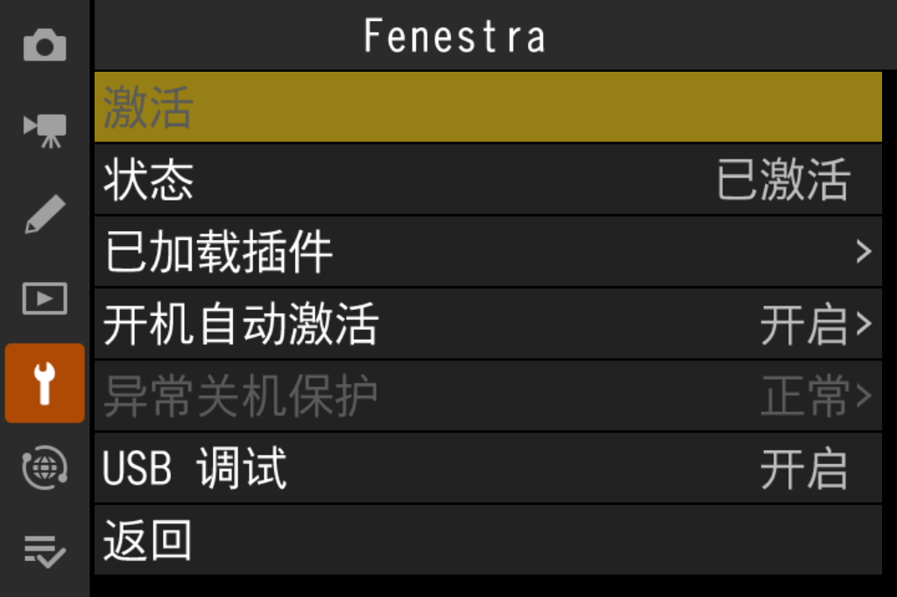
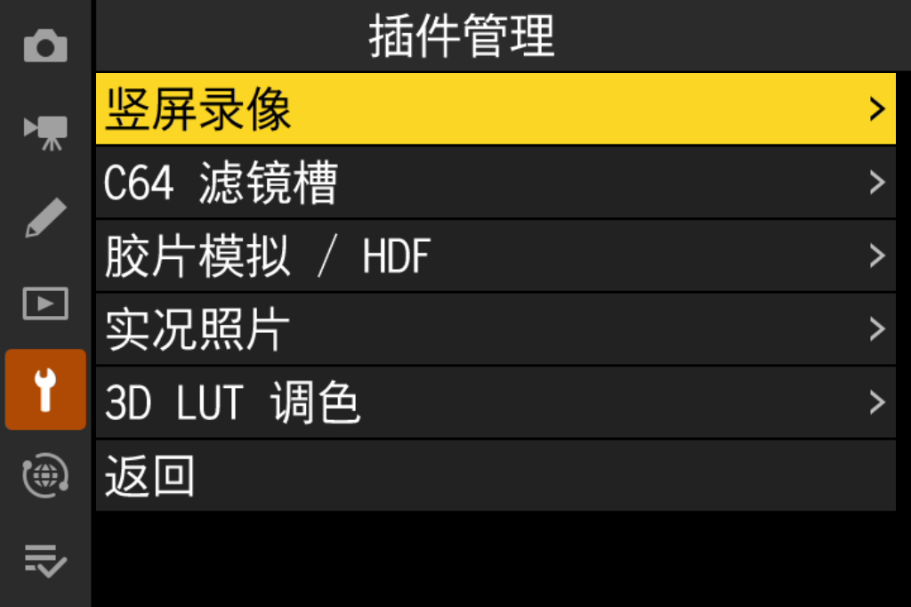
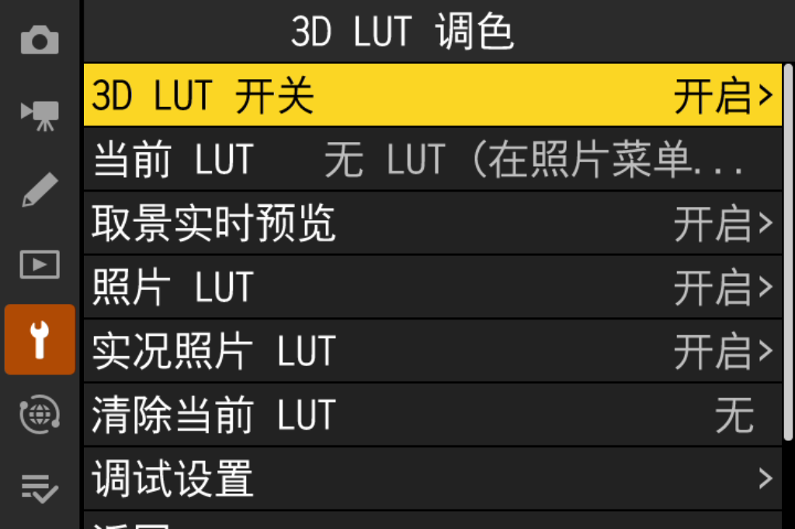
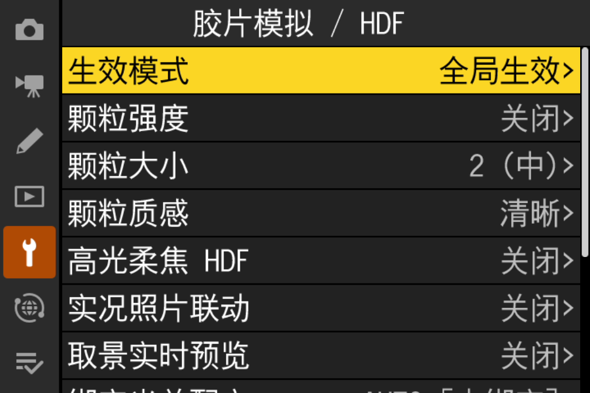
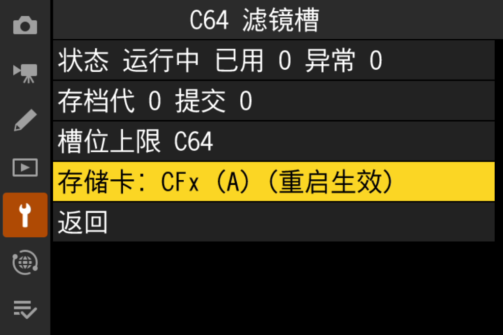
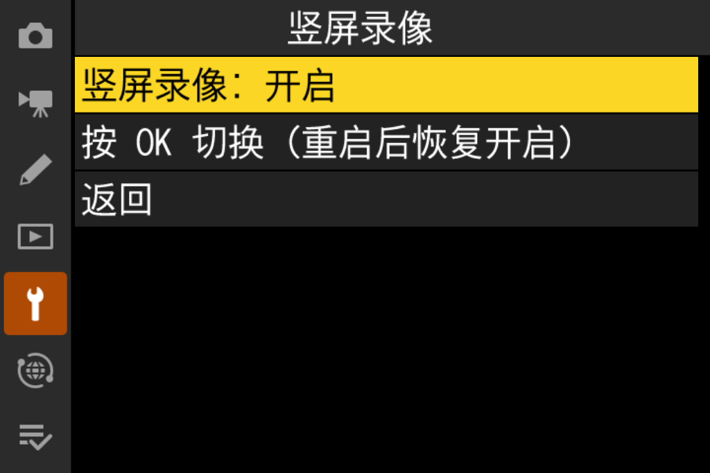

# Z8 QEMU 详细功能与 `V71.7-r7` 仿真验证手册

[English](features-and-usage.md) | **简体中文** | [返回 README](../README.zh-CN.md)

> **定位与边界说明**
> - 本仓库默认分支为 `main`，固定构建上游 **QEMU `10.2.4`**（机器名 `nikon-z8-bringup`）。默认 `tools/build.py` **只编译根目录稳定的 `qemu/` 模型，不会自动应用 `experiments/` 目录下的任何实验补丁**。
> - 本手册同步涵盖 **`z8-qemu` 核心硬件仿真工作流** 与 **配套 [`fenestra-z8`](https://github.com/YCX81/fenestra-z8) `V71.7-r7`（`Z8-v71.7r7-LutPreview-362ee2a5`，内部 `04.06.p0`，Bootguard `0x8394568f`）整机仿真验证及全部 5 款 `.wlm` 插件与照片菜单 3D LUT 参数参考**。
> - 本仓库**不分发**尼康原厂/集成固件二进制、解密密钥、真机传感数据或提取资产（如 `ZF_GRAIN.BIN`）；所有派生 `.main` 镜像仅用于电脑端 QEMU 仿真，**严禁刷入实体相机**。

---

## 一、当前提供什么

| 功能模块 | 使用入口 | 已记录状态与边界限制 |
| :--- | :--- | :--- |
| **Z8 C3.11 辅助启动、原厂菜单、模拟取景** | `Start-Z8.ps1`、`Test-Z8.ps1`；底层 `tools/z8_run.py` | 有菜单往返与像素检查记录；依赖宿主侧虚拟 MCU 与合成 Bayer 输入，非真实 CMOS/ISP 硬件画质。 |
| **`V71.7-r7` 整机仿真与 5 插件验证（配套 `fenestra-z8`）** | 整机集成 `MAIN` + 虚拟 exFAT 卡（7 个核心文件） | 已通过整机 QEMU **`#19-r7`（14/14 PASS）** 与 **`#20-r7`（13/13 PASS）**，`z8_unk = 0`、`panic = 0`：纯净 7 行 `Fenestra`、全部 5 款三语 `.wlm` 插件、照片菜单第 47 项流式 `.cube` LUT + 528 KiB L2 预烘焙 LUT + Movie `0 B` 挂起 + 重启恢复/清除、XM6 自检/回退 UI、`0-diff` `.NEF` 与 EVF Pool #6 内存边界。`V71.7-r7` 标记为 **`physical_camera_verified = false`**。 |
| **C32 / C64 优化校准槽位（NAND 验收）** | `tools/z8_slots_acceptance.py --slots 32/64` | 照片/视频槽位导入、菜单选择、虚拟 NAND 保存及冷重启恢复四阶段验收；默认 `Start-Z8.ps1` 不开启。 |
| **单张 Packed14 与 `F0` 无损 `.NEF` 审计** | `tools/z8_capture_probe.py`、`tools/z8_photo_audit.py` | 单张 `8280×5520` 14-bit 输出有 LibRaw 逐像素比对；**RAW 历史帧预拍尚未完成**，不含 `HE`/`HE*` 压缩微码。 |
| **竖屏 HUD、Wave5、热插拔与 EXMCU 归档实验** | `experiments/20261114/`、`experiments/20261111/` | 独立归档实验补丁，默认 `tools/build.py` 不自动打入。 |

---

## 二、`V71.7-r7`（`Z8-v71.7r7-LutPreview-362ee2a5`）整机仿真与全菜单参考

- **版本身份**：基于官方 Nikon Z8 `C3.11`，内部标识 `04.06.p0`，Bootguard Build ID `0x8394568f`，`MAIN` SHA-256 `362ee2a5491859a762b35ed8459cf22c212ae5babb38915daa15e3b801533c8a`（`81,807,709 B`）。
- **虚拟 exFAT 存储卡 7 个核心交付文件（`FENESTRA/`）**：
  - `STARTUP-Z8.0`（`64 B`）、`filmsim.wlm`（`32,540 B`）、`livephoto.wlm`（`15,860 B`）、`lut.wlm`（`15,624 B`）、`slotcard.wlm`（`56,552 B`）、`portrait.wlm`（`7,348 B`）、`ZF_GRAIN.BIN`（`27,588 B`，用户自备）。
  - 可选 LUT：`FENESTRA/LUTS/<分类>/*.cube` 或 `FENESTRA/*.cube`（单文件 `<= 2 MiB`）。
  - 自动维护双槽 CRC32 配置：`FXPHOTO0/1.CFG`、`FXLUT0/1.CFG`、`FLMSIM0/1.CFG`、`FLMREC0/1.CFG`、`SLTCARD0/1.CFG`、`SCSEL0/1.CFG`、`SC*.REC`、`live-z8.0/1`，以及按需导出的 `XM6_DIAG.LOG` / `LIVELOG.BIN`。

### 2.1 纯净 7 行 `Fenestra` 主菜单与 5 款三语 `.wlm` 插件

| 纯净 7 行 `Fenestra` 主菜单 | `插件管理`（全部 5 款 `.wlm` 插件） |
| :---: | :---: |
|  |  |

`FontCJK-ZhUI` 在中文界面下自动挂载 `CJK_EXT_1` + `CJK_EXT_2`（3,755 简繁汉字，5 款插件 `0` 缺字）；全部 5 款插件每秒轮询 `SLOTS_LANG_GET`（op `15`）实现免重启热切换三语。

### 2.2 原厂照片拍摄菜单第 47 项（`选择 LUT`）与 `lut.wlm`（13 项控件）

| 照片菜单第 47 项（`选择 LUT`） | 分类列表 | `.cube` 文件列表 | 已载入状态 |
| :---: | :---: | :---: | :---: |
|  |  |  |  |
| **实时取景 3D LUT 生效** | **`lut.wlm` 主菜单** | | |
|  |  | | |

- **照片拍摄菜单第 47 项（`0x2DE7`）**：进入 23 行分页子菜单（`Page 0x5D6`），含 `无LUT`、20 项/页（`上一页` / `下一页`）、10 组内置中文分类（`01-Fuji-Film` 至 `10-Creative-Vintage`）+ 自定义目录 + `根目录 LUT`。使用 `V71.7-r7` **528 KiB L2 预烘焙 `64×64×33` YCbCr LUT**（零堆增长，Class `0x24` 冻结于 `0xE8C000`），录像模式 `pool_suspend`（`0 B`），冷重启自动恢复。
- **`lut.wlm` 主页与调试子页**：
  - 主页：`3D LUT 开关`（默认开）、`当前 LUT`、`取景实时预览`（默认开）、`照片 LUT`（默认开）、`实况照片 LUT`（默认开）、`清除当前 LUT`、`调试设置`。
  - 调试子页：`管线与加速`、`图层 0 预览`、`健康与隔离`、`看门狗状态`、`重置预览工作区`。

### 2.3 `filmsim.wlm`（16 项控件）与 EXPEED 7 CEVA-XM6 硬件 DSP 诊断

| `filmsim.wlm` 主菜单 | `filmsim.wlm` 调试子页 | XM6 硬件自检读数 |
| :---: | :---: | :---: |
|  |  |  |

- 主页：`生效模式`（`全局生效` / `按优化校准`，默认 `全局生效`）、`颗粒强度`（`关闭`, `1..6`）、`颗粒大小`（`1 小` / `2 中` / `3 大`，默认 `2 中`）、`颗粒质感`（`柔和 (Zf)` / **`清晰`** 默认）、`高光柔焦 HDF`（`关闭` / `弱 1/8` / `中 1/4` / `强 1/2`）、`实况照片联动`、`取景实时预览`、`绑定当前配方`、`清除当前配方`、`调试设置`。
- 调试子页：`XM6 DSP 模式`（`自动` / `仅 CPU`，默认 `自动`）、`运行 XM6 自检`（导出 `FENESTRA/XM6_DIAG.LOG`）、`重置 XM6 熔断器`、`硬件与运行状态`、`恢复默认设置`。

### 2.4 `livephoto.wlm`（11 项）、`slotcard.wlm`（7 项）与 `portrait.wlm`（5 项）

| `livephoto.wlm` 主菜单 | `slotcard.wlm` 双卡 C64 | `portrait.wlm` 运行期开关 |
| :---: | :---: | :---: |
|  |  |  |

- **`livephoto.wlm`**：主页（`实况照片` 关/开、`快门声音` 开/关全双工 `0.0 ms` 断层、`回放按键` `REC 键`/关、`当前状态`、`调试设置`）；调试子页（`录制统计`、`Wave5 与音频`、`回放与双卡`、`关机保护与日志`、`导出诊断日志`）。
- **`slotcard.wlm`**：主页（`滤镜槽容量` `C64`/`C32`、`存储卡` `自动`/`CFx (A)`/`SD (B)`、`调试设置`）；调试子页（`插槽状态`、`存储日志`、`卡槽引导` `CSL1:...`）。
- **`portrait.wlm`**：主页（`竖屏录像` 开/关运行期即时切换、`调试设置`）；调试子页（`运行状态` `EL1 Gate:<0|1> slots.state:OK`、`说明`）。

### 2.5 `V71.7-r7` 验证矩阵与 QEMU / 实体机边界

| 核验维度 | `362ee2a5` 结果 | 仿真边界与实机要求 |
| :--- | :---: | :--- |
| **CEVA-XM6 `dcli.exe` 仿真与 0-Q-Spill** | **51/51 PASS · `0` spill** | GRAIN `25/25` + HDF `26/26` `0-diff`；`1,114` 函数全量审计。 |
| **Host ASan+UBSan 与 6 套 ARM64/Unicorn** | **全通过** | 覆盖 `r7` 四项流畅度根修（XM6 锁前去竞争、反向 `Layer 0 → Live`、528 KiB L2 烘焙 LUT、快门后 45MP 顺延 `1.65 s` 上限）、FontCJK（5 插件 `0` 缺字）、Layer0（63 项）、XM6 Bridge（124 项）、FilmSim（70 项）与 HangFix。 |
| **整机 QEMU `#19-r7` & `#20-r7`** | **14/14 & 13/13 PASS** | `z8_unk = 0`、`panic = 0`；覆盖 5 插件、Row 47 `.cube` LUT、Movie `0 B` 挂起与冷重启恢复/清除。 |
| **物理 EVF、真实 XM6 硅片与 30fps 实拍** | **`physical_camera_verified = false`** | QEMU 无物理 `1280×960` EVF 面板与真实 XM6 硅片，取景约 24 fps 合成彩条且 Wave5 同步完成（`avg_wait = 0`）。`V71.1–V71.6` 真机实测驱动了 `r7`；**`V71.7-r7`（`362ee2a5`）待实体 Z8 刷写复测**。 |

---

## 三、构建环境、原厂固件输入与核心工作流

```sh
# 1. 构建 QEMU 10.2.4 与合成 Bayer 输入（工作目录放 Linux 原生 ext4）
git clone --branch main https://github.com/YCX81/z8-qemu.git && cd z8-qemu
python3 -m venv "$HOME/.local/share/nikon-z8-qemu/venv"
. "$HOME/.local/share/nikon-z8-qemu/venv/bin/activate"
python -m pip install -r requirements.txt -r requirements-capture.txt -r requirements-c10.txt
python tools/build.py --work-dir "$HOME/.local/share/nikon-z8-qemu/work" --jobs 4
python tools/make_cmos.py
sh tests/run.sh
python tests/check_z8_machine.py \
  --qemu "$HOME/.local/share/nikon-z8-qemu/work/build/qemu-system-aarch64"
```

- 将自行提取的 `81,807,709` 字节原厂 Z8 `C3.11` `MAIN`（`SHA-256: 2b43a31c9de838f84b12416de4348a7004e65be07f853ec56ec2b10f3a8e3853`）放于 `.local/firmware/z8-c311-main.bin`（详见 [firmware.md](firmware.md)）。
- **交互控制台与诊断**：Windows 运行 `.\Start-Z8.ps1` / `.\Test-Z8.ps1`；Linux/WSL 运行 `python tools/z8_run.py --help`。始终核对 `<output>/result.json`。
- **单张 `.NEF` 与 C32/C64 NAND**：分别参考 [z8-capture-probe.md](z8-capture-probe.md)、[z8-photo-audit.md](z8-photo-audit.md) 与 [z8-c32.md](z8-c32.md)（C32 与 C64 NAND 不可混用）。
- **归档实验补丁（`experiments/`）**：操作前先阅读 [progress-20261111.md](progress-20261111.md)，先恢复目标基线并用 `patch --dry-run -p1` 检查上下文。
- **发布审计**：提交前运行 `python -B tools/audit_publication.py`，严禁提交固件、密钥、`ZF_GRAIN.BIN` 或私人素材。
