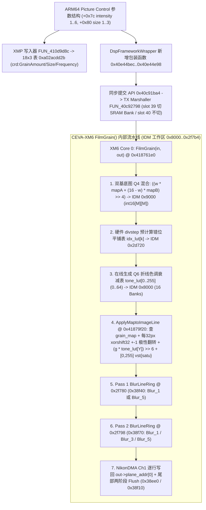

# Nikon Zf C3.01 胶片颗粒（`FilmGrain.cpp`）CEVA-XM6 指令级完整精解报告

基于研究者返回的 [zf_filmgrain_details_v2.json](../zf_filmgrain_details_v2.json)（`189,856` B）、同源固件 z8-c311-main.bin 以及 `xm6asmsrv.dll` + 128-bit PMSS 取指行字节序还原得到的 **1,377 个零误差 VLIW 指令包反汇编** zf_filmgrain_xm6_clean.s，尼康 Zf C3.01 胶片颗粒 DSP 算子本体（`17,084` B）与 ARM64↔DSP 桥接机制已实现 **100% 指令级闭合**。

> [!IMPORTANT]
> **对早期交接摘要的三项核心纠偏（均由 CEVA-XM6 汇编逐指令实锤）**：
> 1. **流水线真实顺序**：并非「先叠加行偏移噪声 → 再模糊噪声图 → 最后按 amount 叠加进画面」，而是 **`ApplyMaptoImageLine` 直接在源亮度行 `Y` 上叠加经 `xorshift32` 逐像素随机翻转极性的 `int16` 颗粒脉冲并饱和至 `[0, 255]`，随后将含噪图像行送入两级串行 `BlurLineRing`（`UpdateBlurLine_1/3/5`）直接写出 DMA**（通过逐像素独立 `±1` 翻转打散平铺周期，再由后续 `1×1 / 3×3 / 5×5 / 7×7 / 9×9` 低通滤波塑出真实胶片颗粒团块与乳剂 MTF 柔化）。
> 2. **4 张 `.Lswitch.table` 的真实性质**：既不是基本块分支跳表，也不是像素格式分发表，而是由 `in->blur_kernel_size`（`in + 0x51`，合法位掩码 `0x2a9` 限定 `{0, 3, 5, 7, 9}`）索引的 **Pass 1（`0x38f40` + 冲刷行数 `0x38ee0`）与 Pass 2（`0x38f70` + 冲刷行数 `0x38f10`）两级串行模糊配置表**。
> 3. **`in + 0x60` 与 `in + 0x70` 的真实身份**：两者均为外部传入的 **`int16_t[M][M]` 预计算颗粒基底图**（`mapA` 与 `mapB`，按 `in + 0x50` Q4 权重线性混合）；阴影/高光衰减查找表 `tone_lut[0..255]` 并非外部指针，而是由 DSP 根据折点 `in + 0x55` / `in + 0x56` 在 IDM `0x8000`（16 存储体广播）在线生成。

---

## 一、端到端架构与 CEVA-XM6 算子流水线

---

## 二、问题 1 完整解答：结构体精确字段偏移表与 `BlurLineRing` 布局

### 2.1 `0x38`（56B）公共图像头 `tagDSPImageParam` 与 `NikonDSPCommonFormat`
由 Z8 `0x40c91c38`（对应 Zf `FUN_40c92de4`）及 `0x40c91420` 平面数解析器指令级交叉证实：

| 偏移 | 大小 | ARM64 类型 | DSP 32-bit 视图 | 字段名 | 语义说明 |
| :--- | :---: | :--- | :--- | :--- | :--- |
| `+0x00` | 8 B | `void*` | `u32 addr0` + `u32 pad0(=0)` | `plane_addr[0]` | Plane 0 首地址（YUV 的 `Y` 亮度平面 / 单平面首地址） |
| `+0x08` | 8 B | `void*` | `u32 addr1` + `u32 pad1(=0)` | `plane_addr[1]` | Plane 1 首地址（YUV Semi-Planar 的交织 `CbCr` 平面 / Planar RGB 的 `G`） |
| `+0x10` | 8 B | `void*` | `u32 addr2` + `u32 pad2(=0)` | `plane_addr[2]` | Plane 2 首地址（Planar RGB `0x50`/`0x51` 的 `B` 平面） |
| `+0x18` | 4 B | `uint32_t` | `uint32_t` | `roi_x` | 有效区域水平像素起点 |
| `+0x1c` | 4 B | `uint32_t` | `uint32_t` | `roi_y` | 有效区域垂直行起点 |
| `+0x20` | 4 B | `uint32_t` | `uint32_t` | `width` | 图像逻辑宽度 $W$（像素数） |
| `+0x24` | 4 B | `uint32_t` | `uint32_t` | `height` | 图像逻辑高度 $H$（行数） |
| `+0x28` | 4 B | `uint32_t` | `uint32_t` | `stride[0]` | Plane 0 行跨距（bytes per line，DMA 32B 对齐） |
| `+0x2c` | 4 B | `uint32_t` | `uint32_t` | `stride[1]` | Plane 1 行跨距 |
| `+0x30` | 4 B | `uint32_t` | `uint32_t` | `stride[2]` | Plane 2 行跨距 |
| `+0x34` | 4 B | `uint32_t` | `NikonDSPCommonFormat` | `format` | 十六进制分组像素格式枚举：`0x00..0x02` Bayer RAW（1P），`0x10..0x12` 单通道 Map（1P），`0x20..0x21` 交织 YUV422（1P），`0x30..0x33` YUV422 Semi-Planar（2P），`0x40..0x43` YUV420 Semi-Planar（2P），`0x50..0x51` Planar RGB（3P），`0x60..0x63` Interleaved RGB（1P），`0x70..0x72` Interleaved RGBA（1P） |

### 2.2 `TFilmGrainInputParam`（DSP 入口 `r0 -> r16`）完整偏移表

| 偏移 | 位宽 / 类型 | 字段名 | DSP 指令证据（zf_filmgrain_xm6_clean.s） | 精确行为与物理意义 |
| :--- | :---: | :--- | :--- | :--- |
| `+0x00` | `u32` (+4B pad) | `src.plane_addr[0]` | `0x41876274`: `LS0.ld (r16.ui).di+#0, r21.di` | 源图像 Plane 0（8-bit 亮度 `Y`）首地址；**DSP 全程不访问 `plane[1..2]` 或 `+0x34 format`** |
| `+0x20` | `int32_t` | `src.width` ($W$) | `0x4187625e`: `LS0.ld (#32+r16.ui).di2+#0, r13.di, r0.di` | 图像行宽（像素数 = DMA 行传输字节数） |
| `+0x24` | `int32_t` | `src.height` ($H$) | `0x4187625e`: 同上双字高字 `-> r0.di` | 图像行数（$H \le 0$ 时跳过主循环） |
| `+0x28` | `int32_t` | `src.stride[0]` | `0x4187626c`: `LS0.ld (#40+r16.ui).di+#0, r3.di` | 输入行字节跨距 |
| `+0x4c` | `int32_t` | `bypass_flag` | `0x41876236` & `0x41876256` (`brrcmp{eq} #1`) | 若等于 `1`，不做任何 DMA 直接返回 `0` |
| `+0x50` | `uint8_t` | `map_blend_weight` ($w$) | `0x41876316`: `LS0.ld (#80+r16.ui).uc+#0, r20.ui` | Q4 混合权重 $w \in [0, 16]$：`((w * mapA + (16 - w) * mapB) >> 4)` |
| `+0x51` | `uint8_t` | `blur_kernel_size` | `0x41877372`: `LS0.ld (#81+r16.ui).uc+#0, r35.ui` | 级联模糊直径档位，掩码 `0x2a9` 严格限定 **`{0, 3, 5, 7, 9}`**，非法返回 `0x10000001` |
| `+0x52` | `uint8_t` | `map_dim` ($M$) | `0x41876284` & `0x41876ae6` | 正方形颗粒基底图边长 $M \le 128$（DMA 尺寸 `2 * M * M` 字节） |
| `+0x53` | `uint8_t` | `tile_period` ($P$) | `0x41876ae6`: `uc2` 高字节 `-> r3.ui` | 错位平铺周期分母 $P$ |
| `+0x54` | `uint8_t` | `tile_step` ($S$) | `0x41876ada`: `LS0.ld (#84+r16.ui).uc+#0, r2.ui` | 每跨越周期 $P$ 附加的错位步长 $S$ |
| `+0x55` | `uint8_t` | `tone_knee_lo` ($K_{\text{lo}}$) | `0x41877000`: `LS0.ld (#85+r16.ui).uc2+#0, r1.ui, r0.ui` | 暗部线性衰减折点（$Y < K_{\text{lo}}$ 时权重由 `0` 升至 `64`） |
| `+0x56` | `uint8_t` | `tone_knee_hi` ($K_{\text{hi}}$) | `0x41877000`: 同上 `uc2` 高字节 `-> r0.ui` | 高光线性衰减折点（$Y > K_{\text{hi}}$ 时权重由 `64` 降至 `0`） |
| `+0x58` | `uint32_t` | `prng_seed` | `0x418773d2` & `0x4187743e` | `xorshift32` 初始种子（传入 `0` 时自动替换为 `0x12345678`） |
| `+0x60` | `u32` (+4B pad) | `mapA_addr` (`const int16_t*`) | `0x418762e0` & `0x41876340` | 颗粒基底图 A（DMA 拷入 IDM `0x15120`，`int16_t[M][M]`） |
| `+0x70` | `u32` (+4B pad) | `mapB_addr` (`const int16_t*`) | `0x418762fc` & `0x41876360` | 颗粒基底图 B（DMA 拷入 IDM `0x21420`，`int16_t[M][M]`） |

### 2.3 `TFilmGrainOutputParam`（`r1`，总大小 `0x38` = 56B）与 `BlurLineRing`（总大小 `0x18` = 24B）
- **`TFilmGrainOutputParam`**：由 ARM64 包装函数 `0x40e44e24`（`orr w1, wzr, #0x38` D-Cache 刷新长度）与 DSP 访存（仅读 `+0x00 dst.plane_addr[0]` 与 `+0x28 dst.stride[0]`，结构体零写入）双重锁定 `sizeof == 0x38`。
- **`BlurLineRing`（IDM 实例：Pass 1 `0x2f780`，Pass 2 `0x2f798`，相距恰为 `0x18` = 24B）**：
  - `+0x00`：`int32_t line_idx`（累计入环计数，每次返回前由 `LS0.rmodw (r3.ui).i+#0, #1` 自增 `1`）
  - `+0x04..+0x14`：`uint8_t* buf[0..4]`（5 个 IDM 行缓冲指针，每条步长 `0x2080 = 8,320` B，起始带 `+32B` 水平镜像前导余量；`UpdateBlurLine_3` 用 `buf[0..2]`，`UpdateBlurLine_5` 用 `buf[0..4]`，每次弹出旧 `buf[0]` 作为本轮输出/空闲复用缓冲并整体左移，实现全流水零内存拷贝）。

---

## 三、问题 2 完整解答：4 张查找表语义、卷积核真值与参数进入路径

### 3.1 四张 10 项 `.Lswitch.table` 的精确分工（两级串行级联）
Clang `SwitchToLookupTable` 将针对 `idx = in->blur_kernel_size`（`in + 0x51`，`0x2a9` 掩码放行 `{0, 3, 5, 7, 9}`）的逻辑编译为两组「函数指针表 + 尾部冲刷（Flush）行数表」：

| `in+0x51` (`idx`) | `0x2a9` 校验 | Pass 1 函数 (`0x38f40`) | Pass 1 Flush (`0x38ee0`) | Pass 2 函数 (`0x38f70`) | Pass 2 Flush (`0x38f10`) | 级联组合与等效空间核 |
| :---: | :---: | :--- | :---: | :--- | :---: | :--- |
| **`0`** | 放行 | `UpdateBlurLine_1` | `0` | `UpdateBlurLine_1` | `0` | **$1\times 1$ 直通**（无模糊，延迟 0 行） |
| **`3`** | 放行 | `UpdateBlurLine_1` | `0` | `UpdateBlurLine_3` | `1` | **$3\times 3$ 二项高斯**（延迟 1 行） |
| **`5`** | 放行 | `UpdateBlurLine_1` | `0` | `UpdateBlurLine_5` | `2` | **$5\times 5$ 真二维高斯**（延迟 2 行） |
| **`7`** | 放行 | `UpdateBlurLine_5` | `2` | `UpdateBlurLine_3` | `1` | **$5\times 5 \circ 3\times 3$ 级联**（等效 $7\times 7$，延迟 3 行） |
| **`9`** | 放行 | `UpdateBlurLine_5` | `2` | `UpdateBlurLine_5` | `2` | **$5\times 5 \circ 5\times 5$ 级联**（等效 $9\times 9$，延迟 4 行） |
| `1,2,4,6,8` | 拦截 | — | — | — | — | 直接跳 `.LBB0_62` 返回错误码 `0x10000001` |

### 3.2 三个常量池与空间模糊核精确数学定义
1. **`.LCPI2_0`（`0x00038e80`，`u8 = [2, 1, 4, 2, 0...]`）$\to$ `UpdateBlurLine_3`**：
   - 可分离 `rank = 1` 二项式核，权重和 $16 = 2^4$；`VSWGENMAC` 采用 `post_shift = 4` 且无 `{rnd}` 修饰符（**纯截断向下取整 `>> 4`，不加 `+8`**），水平与垂直首尾均严格执行 **`BORDER_REFLECT_101`**（`src[-1]=src[1]`，`src[W]=src[W-2]`）：
     $$B_3[y, x] = \left\lfloor \frac{1}{16} \sum_{dy=-1}^{1}\sum_{dx=-1}^{1} K_3[dy+1, dx+1]\, I[y+dy, x+dx] \right\rfloor, \quad K_3 = \begin{bmatrix}1&2&1\\2&4&2\\1&2&1\end{bmatrix}$$
2. **`.LCPI3_0`（`0x00038ea0`，`u8 = [15, 26, 15, 3, 26, 40, 26, 7, 0...]`）$\to$ `UpdateBlurLine_5`**：
   - **真二维不可一维分离八边形高斯核**（四角严格为 `0`，$\det\begin{bmatrix}0&7\\7&40\end{bmatrix} = -49 \ne 0$，矩阵秩 $\operatorname{rank}(K_5) = 3$，拟合 $\sigma \approx 1.01\text{ px}$，权重和 $13 + 62 + 106 + 62 + 13 = \mathbf{256 = 2^8}$）；`VMAC3` 右移 `r26 = 8` 无 `{rnd}`（**纯截断 `>> 8`，不加 `+128`**），边界同样严格为 **`BORDER_REFLECT_101`**：
     $$B_5[y, x] = \left\lfloor \frac{1}{256} \sum_{dy=-2}^{2}\sum_{dx=-2}^{2} K_5[dy+2, dx+2]\, I[y+dy, x+dx] \right\rfloor, \quad K_5 = \begin{bmatrix}0&3&7&3&0\\3&15&26&15&3\\7&26&40&26&7\\3&15&26&15&3\\0&3&7&3&0\end{bmatrix}$$
3. **`.LCPI4_0`（`0x00038ec0`，`u8 = [16..31, 0..15]`）$\to$ `ApplyMaptoImageLine`**：
   - 256-bit 向量高低 128-bit 半通道交换掩码，配合 `0, -32, -64, -96` 偏移的 4 级级联 `vlut` 实现单行 128 个 `int16` 颗粒抽头的并行查表。

---

## 四、问题 3 完整解答：噪声机制（双图 + PRNG）、亮度单通道与饱和钳位

1. **同时使用「预计算双 `int16` 颗粒基底图」与「在线 Marsaglia `xorshift32` 随机极性翻转」**：
   - **基底图混合**：$\text{grain\_map}[r, c] = \operatorname{int16}\bigl((w \cdot \text{mapA}[r, c] + (16 - w) \cdot \text{mapB}[r, c]) \gg 4\bigr)$。
   - **错位平铺去接缝**：$\text{idx\_lut}[k] = \bigl(\lfloor k / P \rfloor \cdot S + (k \bmod P)\bigr) \bmod M$。
   - **逐 32 像素块 `xorshift32` 符号翻转**：每处理 32 个像素更新一次 `state ^= state << 13; state ^= state >> 17; state ^= state << 5;`（`seed == 0` 时取 `0x12345678`），按 `state` 的第 `0..31` 位逐像素决定极性（`bit == 1` 取 `+g`，`bit == 0` 取 `-g`）。这既保留了基底图的幅值分布，又彻底消除了 `128×128` 贴图在大画幅图像上平铺的周期性网格伪影。
2. **仅作用于亮度通道 `Y`（`plane_addr[0]`），色度 `CbCr` 完全不叠加颗粒**：
   - `FilmGrain()` 全程只读写 `plane_addr[0]` 单通道 `uint8` 平面，不触碰 `plane_addr[1..2]`，符合纯单色银盐胶片颗粒物理模型；同时按像素亮度查 Q6 折线表 `tone_lut[Y]`（暗部 `< knee_lo` 与高光 `> knee_hi` 线性衰减至 `0`，中间调恒为 `64`）。
3. **精确乘加移位与 `[0, 255]` 硬件饱和钳位**：
   - `VPU.vmpy ..., #0x6` 执行二补数算术右移 6 位（向 $-\infty$ 截断，无 `+32` 偏置），随后经 `VPU0.vaddsat`（`int16` 饱和加）与 `LS1.vst{satu}`（**无符号 8-bit 硬件饱和存储**）严格钳位至 **`[0, 255]`**：
     $$\Delta[y, x] = \Bigl(\operatorname{int16}\bigl(\text{sign}_{y,x} \cdot \text{grain\_map}[\text{idx\_lut}[y], \text{idx\_lut}[x]]\bigr) \cdot \text{tone\_lut}[Y_{y,x}]\Bigr) \gg 6$$
     $$Y_{\text{noisy}}[y, x] = \operatorname{clip}\bigl(Y[y, x] + \Delta[y, x],\; 0,\; 255\bigr)$$

---

## 五、ARM64 侧全链路闭合（`v3` Ghidra 反编译实锤）与本地引擎对齐验证

基于 `zf_filmgrain_arm64_maps_v3.json`（SHA-256 `c1b878c4...d8625`）返回的 `FUN_40e44bec` 及其全部 6 个调用者与 4 个 `FUN_410234xx` 基底图访问器，ARM64 侧参数构造链路已 **100% 闭合**：

### 5.1 `FUN_40e44bec`（`0x40e44bec..0x40e44e7b`，656 B）与 6 处 ISP 调用者
- **`slot 39`（`0x27`）vs `slot 40`（`0x28`）真实分工**：
  - `*(uint8_t *)(param_1 + 0x10) == 0` $\to$ **`slot 39`**（TX Marshaller `FUN_40c92798` 启动前切 Group-3 SRAM Bank 给 XM6 Core 0）：静态拍摄主链 `FUN_40e6f440`、二次/RAW 机内处理 `FUN_40e71620` / `FUN_40e71cc0`、回放/润饰 `FUN_40e7276c`、缩略图/缩放 JPEG `FUN_40e78eec`（均读取 `job + 0x1a0c` 使能、`+0x1a10` 强度 `0..5`、`+0x1a14` 大小 `0..2`，仅在 `enable == 1 && *job != 2` 时将中间 YUV 落地 DRAM 后原地加颗粒再编码）。
  - `*(uint8_t *)(param_1 + 0x10) == 1` $\to$ **`slot 40`**（不切 SRAM Bank）：LiveView / 视频实时流 `FUN_40e5d5b4`（读取 `job + 0x908 / +0x90c / +0x910`）。
- **固定硬编码标量（写入共享结构体 `0xa1be9ebe0`, `sizeof = 0x80`，原地写回 `0xa1be9ec60`, `sizeof = 0x38`）**：
  - `in+0x34 format = 0x10`（单通道 8-bit `Y`）；`in+0x4c bypass_flag = 0`；
  - `in+0x52 map_dim = 0x53`（**$M = 83$**，质数！`in+0x68` / `in+0x78` 同步写入 `0x53`）；
  - `in+0x53 tile_period = 5`（**$P = 5$**，质数！）；`in+0x54 tile_step = 0x17`（**$S = 23$**，质数！三质数配合提供 $5 \times 83 = 415$ 像素无重复错位周期）；
  - `in+0x55 tone_knee_lo = 0x20`（**`32`**）；`in+0x56 tone_knee_hi = 0xdf`（**`223`**，严格关于 `127.5` 对称）；
  - `in+0x58 prng_seed`：每帧调用 `FUN_40c7d584(&local_48)`，指令级实为 `low32(umulh(CNTPCT_EL0, 0xAAAAAAAAAAAAAAAA) >> 4)`（即 24 MHz ARM 通用定时器周期计数器 `CNTPCT_EL0 / 24` 的微秒计数低 32 位，非墙上时钟；复现时需固定该种子）；
  - `in+0x60 / +0x70` 缓冲布局与 D-Cache 维护：ROM 中 Map 0 与 Map 1 严格相接差 `0x35d2`（`13,778` B），但运行期 DMA 缓冲按 64 字节对齐相距 `align_up(0x35d2, 64) = 0x35e0`（`13,792` B），且 `mapB` **始终全零填充**（`memset(mapB, 0, 0x35d2)`）；提交 RPC 前调用 `FUN_40d30e58`（`dc CIVAC`）依次刷清 `mapA`、`mapB`、`in`（`0xa1be9ebe0`, `0x80` B）与 `out`（`0xa1be9ec60`, `0x38` B）。

### 5.2 真正的 EXPEED 7 DSP 标量查表（`0xa02aec1f8..0xa02aec209`，18 B）与两张实机 `83×83` `int16_t` 基底图（`v4` 闭合）
- **18×3 表 `0xa02acdd2b` 身份盖棺**：仅用于 `FUN_410d9d8c` 写入 Adobe XMP（`crd:GrainAmount/Size/Frequency`），其随 `Size 1→2→3` 递减的 `GrainAmount`（如 4 档 `82 : 65 : 45 = 1.00 : 0.79 : 0.55`）正是为了在 Lightroom 中拟合硬件 `3×3 / 5×5 / 9×9` 模糊带来的 RMS 衰减比（实测 `1.00 : 0.77 : 0.56`）。
- **真 DSP 参数查表（共 18 B，位于 `.data` RAM `0xa02aec1f8` / ROM `0x44bbb1f8` / 文件偏移 `0x4a5b1f8`）**：
  - **全分辨率模式**（`*(u8*)(param_1 + 0x11) == 0`，正常静态照片与视频）：
    - `in+0x50` Q4 权重 `w`（`0xa02aec201`, 6 B）：**`[2, 3, 7, 11, 16, 16]`**（对应菜单强度 `1..6`，0 基下标 `0..5`）
    - `in+0x51` 模糊核直径（`0xa02aec207`, 3 B）：**`[3, 5, 9]`**（大小 1 $\to 3\times 3$，大小 2 $\to 5\times 5$，大小 3 $\to 5\times 5 \circ 5\times 5$ 等效 $9\times 9$）
  - **低分辨率/缩略图模式**（`*(u8*)(param_1 + 0x11) == 1`，`FUN_40e78eec` 中 `param_1[0x19d4] == 0`）：
    - `in+0x50` Q4 权重 `w`（`0xa02aec1f8`, 6 B）：**`[2, 2, 3, 4, 6, 9]`**
    - `in+0x51` 模糊核直径（`0xa02aec1fe`, 3 B）：**`[3, 3, 3]`**（三档大小均钳位至 $3\times 3$ 且恒用 Map 0）
- **两张完整实机 `83 × 83` `int16_t` 基底图（[zf_filmgrain_maps_83x83_v4.json](../zf_filmgrain_maps_83x83_v4.json)，`29,403` B，SHA-256 `05efd2be...59714`；`FUN_41023444` 起始已是浮点函数，确认全固件仅此两张表）**：
  - **Map 0（标准基底图，`FUN_4102341c`）**：RAM `0xa02b7237c` / ROM `0x44c4137c` / 文件偏移 `0x4ae137c`，`13,778` B，SHA-256 `d36cfcbfa644599818260d74eeb02f4ff2775bc94b8c529be7c9e66add8e161e`；全表 `min = -267`, `max = 269`, `mean = +0.2546`, **`std = 63.7841`**（$\approx 64$）, `kurtosis = 3.0516`, `lag1_H = +0.0007`, `lag1_V = +0.0006`（标准独立同分布高斯白噪声 $\mathcal{N}(0, 64^2)$ 量化）。
  - **Map 1（高幅基底图，`FUN_41023430`）**：RAM `0xa02b7594e` / ROM `0x44c4494e` / 文件偏移 `0x4ae494e`，`13,778` B，SHA-256 `0d50aedb83a3b4488c0fa9dabdf28b228bea0fa072122104120d0907eb1cfd41`；全表 `min = -342`, `max = 334`, `mean = +1.1603`, **`std = 95.9047`**（$\approx 96 = 1.5 \times 64$）, `kurtosis = 3.0547`, `lag1_H = +0.0013`, `lag1_V = -0.0076`, 与 Map 0 相关系数 `r = +0.0207`（完全独立采样实现的 $\mathcal{N}(0, 96^2)$，仅在全分辨率且强度 `6` 时切入）。

### 5.3 本地参考实现更新与真 ROM 表 100% 闭环自测
- 已将 [zf_filmgrain_maps_83x83_v4.json](../zf_filmgrain_maps_83x83_v4.json)（真 ROM 双 `83×83` 表）与全部 ARM64 + CEVA-XM6 参数表合入 [expeed7_flexible_color_tables.json](../expeed7_flexible_color_tables.json) 与 [nikon_zf_film_engine.py](../nikon_zf_film_engine.py)，执行 `--self-test` **29/29 项全量 PASS**（含两张实机 `83×83` 表 SHA-256 逐字节校验与全 18 档颗粒单调/宽度验证）。
